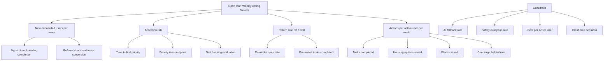

# 02 — Product Strategy (PM + Marketing hats)

**TL;DR**
1. Primary persona: an international student who arrives in three weeks with no housing; second: a domestic first-time renter.
2. The "aha moment" is seeing your own ranked priorities with a countdown, within 90 seconds of opening the app.
3. Every feature in both specification documents has a tier below; anything not scheduled in R0–R3 is parked with a trigger or refused.
4. The MVP is done when seven measurable outcomes hold (section 5), not when the screens exist.
5. Analytics is a typed, content-free event taxonomy (section 10); the first experiments are listed in section 11.

Sources: "spec §N" is `docs/student_life_relocation_agent_focused_mvp.md`; "vision §N" is `docs/student_life_relocation_agent_mvp.md`; "design" is the Tide design artifact.

---

## 1. Personas

| | **P1 — Aarav, 22** | **P2 — Maya, 19** | **P3 — Lena, 21** |
|---|---|---|---|
| Who | International master's student, Pune → Phoenix | Domestic first-time renter, small town → Chicago | Exchange student, Hamburg → Toronto, one semester |
| Timing | Arrives in 3 weeks | Moves in 5 weeks | Arrives in 10 days, lands at 23:40 |
| Housing | **Not secured**; scanning listings in social groups | Not secured; never signed a lease | Secured (sublet) |
| Money | Fixed monthly budget, large one-off costs frighten him | Tight budget, part-time job | Stipend, limited cash for the first week |
| Device | Android phone first, laptop second | iPhone | iPhone, laptop |
| Fears | Being scammed on a deposit; landing with no phone data; forgetting something critical | Hidden costs; looking naive to a landlord | Arriving late at night; getting to the flat; first food and SIM |
| Today's tools | WhatsApp and Telegram groups, Reddit, spreadsheets, a general chatbot | Parents, TikTok advice, listing sites | University welcome PDF, Google Maps |
| What "done" looks like | "I know where I'm staying, what it really costs, and my first day is planned" | "I can afford it and I know the next step" | "I got home safely and my first week is sorted" |

Secondary persona, not targeted before R4: **Sam, 24**, a young professional relocating for a first job (vision §3 "Future").

Anti-personas: a parent running the move for a student; a university administrator; anyone seeking visa, legal, medical or academic advice.

## 2. Jobs to be done

| # | When… | I want to… | So that… | Served by |
|---|---|---|---|---|
| J1 | I have just decided where I am going | see the few things that matter most right now | I stop feeling lost | Dashboard, priority engine |
| J2 | I find a place to rent | know the real monthly cost and the cash I need on day one | I do not run out of money or overcommit | Housing evaluation |
| J3 | a listing looks too good | check the warning signs | I do not lose a deposit | Risk checklist, guardrailed explanations |
| J4 | my arrival day approaches | have a first-24-hours list that works offline | I get home, connected and fed | Plan, offline cache (R2) |
| J5 | I have a question about my move | ask someone who knows my situation | I get a specific answer, not a lecture | Concierge |
| J6 | I reach my new home | find groceries, a pharmacy, a clinic, transit and laundry nearby | I can live there from day one | Essential places |
| J7 | my plans change | have the plan adjust itself | I do not have to start again | Reconciliation on profile change |

## 3. Journey map by lifecycle phase

| Phase | Window | User is doing | Feeling | Product's job | Screen |
|---|---|---|---|---|---|
| Decide | 4–8 weeks before | Collecting advice from everywhere | Overwhelmed, hopeful | Onboard in under 90 seconds; show 3–4 priorities with reasons | Onboarding, Dashboard |
| Prepare (SURVIVE) | 1–4 weeks before | Housing search, transport, phone, money | Anxious about money and scams | Honest cost math; scam checklist; calm reminders | Housing, Tasks, Concierge |
| Arrive (SURVIVE) | Day 0–1 | Travel, access home, connect, eat, rest | Exhausted, alert, possibly offline | First 24 Hours checklist that works offline; one primary action | Plan (24 hours), Places |
| Settle | Days 2–7 | Home basics, food, routes, money setup | Relieved, still fragile | Themed first week; nearby essentials | Plan (7 days), Places |
| Live (DISCOVER, THRIVE) | Week 2 onward | Routine, exploring, meeting people | Curious | Ongoing tasks now; deeper agents later (R4) | Plan (ongoing) |

## 4. MoSCoW: every feature in both specifications

Tiers: **MUST** (needed to prove the promise), **SHOULD** (clear value, ships after the core), **COULD** (nice, cheap), **WON'T-yet** (parked with a trigger in `14_PARKING_LOT.md`), **REFUSED** (permanent).

### 4.1 Features of the focused MVP (spec §3–§4, §18)

| Feature | Source | Tier | Release | Reason |
|---|---|---|---|---|
| Create account, sign in, sign out | spec §3.1 | MUST | R0 | Nothing is personal without identity; Google only at first (ADR-0005) |
| Manage basic profile | spec §3.1 | MUST | R1 | Plan must follow changed facts |
| Onboarding: origin, destination, arrival date | spec §3.2 | MUST | R0 | Minimum input for the first priority |
| Onboarding: arrival time (optional) | spec §3.2 | MUST | R1 | Drives the late-arrival rules |
| Onboarding: monthly budget, housing status, housing budget | spec §3.2 | MUST | R0 | Needed for housing priority and verdicts |
| Onboarding: transportation preference | spec §3.2 | MUST | R1 | Changes baseline tasks |
| Onboarding: basic interests | spec §3.2 | WON'T-yet | PL-18 | No MVP feature uses it; collecting unused data breaks minimisation |
| Plan in four phases | spec §3.3 | MUST | R1 | Core promise |
| Plan updates when key facts change | spec §3.3 | MUST | R1 | J7 |
| Top priorities on the dashboard | spec §3.4 | MUST | R0 (one), R1 (ranked) | "What should I do next?" |
| Priority considers safety, arrival dependency, deadline, financial impact, user context | spec §3.4 | MUST | R1 | Deterministic specifications (S-R1-007) |
| View, complete, reopen tasks; see why | spec §3.4 | MUST | R1 | Acceptance criteria 4–5 |
| No giant checklist | spec §3.4 | MUST | R1 | Dashboard shows at most four; future phases collapsed |
| Housing cost entry by hand | spec §3.5 | MUST | R1 | Acceptance criterion 6 |
| Paste listing text to pre-fill | spec §3.5 | SHOULD | R1 | High perceived value; first item to cut if R1 runs long |
| Real monthly housing cost | spec §3.5 | MUST | R1 | J2 |
| Move-in cash required | spec §3.5 | MUST | R1 | J2; acceptance criterion 7 |
| AI explanation of budget fit | spec §3.5 | MUST | R1 | AI explains, code decides |
| Never invent listings, availability, prices, legitimacy | spec §3.5, §23 | MUST | R1 | Guardrail + test + story (S-R1-049, S-R1-063) |
| Essential places: grocery, pharmacy, healthcare, transit, laundry | spec §3.6 | MUST | R1 | J6 |
| Place name, distance, address, category, directions link | spec §3.6 | MUST | R1 | Acceptance criterion 8 |
| Concierge grounded in user context | spec §3.7 | MUST | R1 | J5; acceptance criteria 9–10 |
| Screens: onboarding, dashboard, plan, tasks, housing, concierge, settings | spec §4 | MUST | R0–R1 | Plus places and sign-in, which the spec's list omits |
| Domain events for plan regeneration | spec §18 | MUST | R1 | ADR-0017 |
| First 24 Hours and First 7 Days are followable | spec §25.11–12 | MUST | R1 | Items are checkable tasks, not prose |
| Comfortable on mobile | spec §25.13 | MUST | R1 | Mobile-first layouts |
| Compare housing options | spec §9.2 | SHOULD | R1 | In the Housing Agent's responsibilities; cut after paste if needed |
| Flag potential housing risks | spec §9.2; vision §12 | MUST | R1 | Deterministic flags and risk checklist |

### 4.2 Features of the long-term vision (vision §7–§51)

| Feature | Source | Tier | Release | Reason |
|---|---|---|---|---|
| Travel and arrival agent (flight, baggage, documents) | vision §7 | WON'T-yet | PL-17 | Baseline arrival tasks cover the essentials |
| Late-arrival handling | vision §49 sc. 3 | MUST | R1 | Cheap rule, high safety value (S-R1-010) |
| Housing preferences and recommendations from listings | vision §8, §10, §35 | WON'T-yet | PL-15 | Needs licensed listing data; never invented |
| Housing affordability engine | vision §9 | MUST | R1 | Same as spec §3.5 |
| "Housing Fit %" and star ratings | vision §9–§10 | WON'T-yet | PL-15 | Pseudo-precision without listing data |
| Neighbourhood intelligence | vision §11 | WON'T-yet | PL-16 | Needs authoritative data; crime claims are risky |
| Housing scam protection | vision §12 | MUST | R1 | Checklist, mandatory warning text, guardrails |
| Move-in cost calculator | vision §13 | MUST | R1 | Same as spec §3.5 |
| Phone and connectivity agent | vision §14, §23 | WON'T-yet | PL-01 (S-R4-001) | A baseline task covers it in R1 |
| Home internet agent | vision §15 | WON'T-yet | PL-02 | Needs provider data |
| Grocery and food agent | vision §16 | WON'T-yet | PL-07 (S-R4-005) | Concierge gives a generic first-shop answer in R1 |
| Essential places beyond five categories (bank, ATM, hardware, parks…) | vision §17 | WON'T-yet | PL-24 | Add categories when place usage shows demand |
| Transportation agent, first five routes | vision §18; design | WON'T-yet | PL-06 (S-R4-004) | Needs a routing API; R1 gives "Open in Maps" links |
| Money and budget agent | vision §19 | WON'T-yet | PL-04 (S-R4-003) | Budget is collected and used for verdicts only |
| Banking and payments guidance | vision §20 | WON'T-yet | PL-05 | Regulated-advice risk |
| Health and wellness agent | vision §21 | WON'T-yet | PL-08 (S-R4-006) | Places covers "find a clinic" |
| Safety and emergency plan | vision §22 | WON'T-yet | PL-03 (S-R4-002) | R1 ships baseline safety tasks and an emergency guardrail only |
| Life skills coach | vision §24 | WON'T-yet | PL-13 | Not needed to prove the promise |
| Routine agent | vision §25 | WON'T-yet | PL-12 (S-R4-008) | THRIVE phase |
| Activity discovery | vision §26, §48 | WON'T-yet | PL-09 (S-R4-007) | DISCOVER phase |
| Activity DNA | vision §27 | WON'T-yet | PL-10 | Depends on activities |
| Community and social recommendations | vision §28 | WON'T-yet | PL-11 | Depends on activities |
| One orchestrator, shared context, AI service layer | vision §29, §32, §33 | MUST | R1 | ADR-0007, ADR-0008 |
| Hybrid recommendation architecture | vision §34 | WON'T-yet | PL-15 | Nothing to rank yet |
| Notifications (in-app, email, push later) | vision §38 | SHOULD | R2 | Retention loop; ADR-0026 |
| Life Readiness score | vision §43; design | SHOULD | R2 | Motivating, cheap, but not needed to prove the promise |
| Dashboard "My Life" domain grid | vision §44; design | SHOULD | R2 | Ships with readiness; same category roll-ups |
| First 24 Hours list | vision §46 | MUST | R1 | Template content for the baseline plan |
| First 7 Days themed days | vision §47 | MUST | R1 | Template content |
| Limited-budget scenario | vision §49 sc. 4 | COULD | R1 (partial) | Budget-aware reasons in baseline tasks; no dedicated flow |
| Security and privacy list | vision §53 | MUST | R0–R2 | Auth, validation, rate limits (R0–R1); deletion, export, audit (R2) |
| Landing page | vision §54 | SHOULD | R2 | Needed for the open beta, not for the closed one |
| Testing requirements | vision §55 | MUST | R0 onward | ADR-0022 |
| Native mobile apps | spec §24; vision §51 | SHOULD | R2–R3 | Required by the planning brief; delivered as Capacitor shells (ADR-0001) |
| University integrations, academic services, university dashboard | spec §24; vision §2, §51 | REFUSED | — | Product boundary |
| Social network | spec §24 | REFUSED | — | Attention product; see `01_EXECUTIVE_BRIEF.md` §4 |
| Direct leasing, payments, banking transactions, telecom activation, grocery delivery, transport booking, marketplace | spec §24; vision §51 | WON'T-yet | PL-26 | Transactions need partners and regulation |
| Parent portal | spec §24 | WON'T-yet | PL-23 | Different user, different consent model |
| Microservices, Kubernetes | spec §24 | REFUSED for the plan horizon | — | Modular monolith (ADR-0002) |

### 4.3 Features added by the planning brief or the design

| Feature | Source | Tier | Release | Reason |
|---|---|---|---|---|
| Google sign-in | brief | MUST | R0 | Hard constraint 5 |
| Sign in with Apple, magic link | brief; App Store 4.8 | MUST for stores | R2 | Needed before any iOS build offers Google login |
| Installable PWA, offline cache | brief | SHOULD | R2 | J4 |
| Push and reminders | brief | SHOULD | R2 | Retention |
| Data export and account deletion | brief; App Store 5.1.1(v) | MUST for stores | R2 | Privacy and store rule |
| Housing options A/B tabs, compare table | design | SHOULD | R1 | Same as spec §9.2 |
| Risk checklist ("did the listing…") | design; vision §12 | MUST | R1 | Deterministic safety |
| Desktop sidebar layout with arrival countdown | design | MUST | R1 | Desktop is a target platform |
| Concierge context tags and "via agent" label | design | MUST | R1 | Shows grounding; builds trust |
| Stage strip Survive → Thrive | design | SHOULD | R2 | Ships with readiness |
| Embedded map | design | COULD | R3 (S-R3-038) | List + links suffice first |
| Referral loop, city guides, store listings | brief | SHOULD | R3 | Growth |
| Spanish and Simplified Chinese | brief | SHOULD | R3 | ADR-0025 |

## 5. MVP definition of done (measurable)

The MVP (end of R1) is done when all of these hold in the production environment:

1. A new user reaches a dashboard with personalised priorities in a median of ≤ 90 seconds from the sign-in screen (measured by `time_to_first_priority` in R2; by timed test sessions in R1).
2. All 13 acceptance criteria of spec §25 pass as automated end-to-end tests (S-R1-089).
3. The safety golden set passes 100% (S-R1-063): no invented listing, price, availability or performed action in any evaluated output.
4. Every number shown in Housing equals the output of `@slj/domain` functions for the same inputs (contract test).
5. With no LLM key configured, every screen still works and answers come from the heuristic provider.
6. p95 latency of non-AI API routes is ≤ 300 ms and concierge first token is ≤ 2.5 s p95 on the configured provider.
7. Accessibility: zero serious or critical axe violations on the seven core screens (S-R1-090).

## 6. Activation ("aha moment") and the shortest path to it

**Aha:** "This already knows my situation and it is telling me the one thing to do first."

**Activation event:** within 24 hours of `onboarding_completed`, the user does at least one of: completes a task, opens a priority's reason, saves a housing evaluation.

**Shortest path (target ≤ 90 seconds, ≤ 12 taps):**

| Step | Screen | Input | Seconds |
|---|---|---|---|
| 1 | Sign in | "Continue with Google" | 10 |
| 2 | Onboarding 1 of 3 — Route | From, To (autocomplete), arrival date, optional time | 30 |
| 3 | Onboarding 2 of 3 — Money and housing | Monthly budget, housing status, housing budget if searching | 25 |
| 4 | Onboarding 3 of 3 — Getting around + confirm | Transport chips (preselected), age and terms checkbox, "Show my plan" | 15 |
| 5 | Dashboard | Countdown, housing banner, up to four priorities | 0 (the baseline plan is computed in the same request) |

No LLM call sits on this path (ADR-0007 rule 2).

## 7. Retention loops

| Loop | Trigger | Action | Reward | Investment | Release |
|---|---|---|---|---|---|
| Progress | Open the app | Complete a priority | Next priority appears with a reason; toast "Done" | The plan becomes more theirs | R1 |
| Money clarity | Find a listing | Paste or enter numbers | Verdict + move-in cash + comparison | Saved options | R1 |
| Countdown | Arrival approaches | Reminder at 7 days, 2 days, arrival day | A short, timely list | Notification permission | R2 |
| Readiness | Task completed | Score and stage update | Visible progress toward "Settle" | — | R2 |
| Share | A friend is moving too | Send an invite link | Both see a "moving together" note; no payment | Social proof | R3 |

## 8. Metrics tree

## 9. Product decisions that change the specifications

| # | Decision | Why |
|---|---|---|
| 1 | Everything actionable is a **task**. First 24 Hours and First 7 Days items are task rows with `phase` and `dayIndex`, not prose in a plan document. | Makes spec §25.11–12 ("follow a plan") checkable and keeps one model |
| 2 | The plan is **deterministic first**: a baseline from rules, then AI enhancement. | Activation never waits for an LLM; safe at $0 |
| 3 | Interests are not collected. | Unused in R0–R3 |
| 4 | Housing verdict thresholds follow the design: COMPATIBLE when real monthly cost ≤ housing budget, TIGHT when ≤ 110% of it, OVER above; **UNKNOWN** when no housing budget exists. | The prototype compared housing cost with the whole monthly budget (D-28), which misleads |
| 5 | Housing is reached from Home, tasks and the concierge on mobile (five tabs: Home, Plan, Tasks, Places, Chat) and has its own sidebar entry on desktop. | Matches the design; keeps five tabs |
| 6 | The concierge never changes data. It may propose actions rendered as buttons. | Safety rule "never claim an action happened" |
| 7 | One currency per user, minor units everywhere. | Removes float errors and hard-coded USD (D-09) |
| 8 | Sample data is always labelled. With no places key the screen says "Demo mode". | Spec §23 |
| 9 | Users attest they are 16 or older at onboarding. | Minors policy, `06_DATA_AND_AUTH.md` §15 |

## 10. Event taxonomy

All events carry `platform` (`web`, `pwa`, `ios`, `android`), `appVersion` and `locale`. Properties are enums, booleans, counts or buckets only (ADR-0020). Owner is the hat accountable for acting on the metric. Source `S` = emitted by the API, `C` = sent by the client through `/api/v1/events`.

| Event | Src | Properties | Owner | Purpose |
|---|---|---|---|---|
| `sign_in_completed` | S | `method`, `isNewUser` | PM | Acquisition funnel |
| `onboarding_started` | C | — | PM | Funnel start |
| `onboarding_step_completed` | C | `step` (1–3) | Design | Find the step that loses people |
| `onboarding_completed` | S | `housingStatus`, `daysUntilArrivalBucket`, `hasArrivalTime`, `transportPrefCount` | PM | Funnel end, cohorts |
| `plan_generated` | S | `trigger`, `generatedBy`, `taskCount`, `version` | PM | Plan health |
| `plan_enhanced` | S | `providerKind`, `fallbackUsed`, `addedTaskCount` | Tech Lead | AI value and reliability |
| `dashboard_viewed` | C | `journeyPhase`, `openCriticalCount` | PM | Engagement |
| `priority_reason_opened` | C | `category`, `priority` | PM | Activation signal |
| `task_completed` | S | `category`, `priority`, `phase`, `source`, `surface` | PM | North star input |
| `task_reopened` | S | `category` | PM | Mis-taps, regret |
| `task_created` | S | `phase` | PM | Do users extend the plan? |
| `housing_evaluated` | S | `verdict`, `riskFlagCount`, `depositAssumed`, `inputSource` | PM | Bet 2 |
| `housing_option_saved` | S | `verdict` | PM | North star input |
| `housing_compared` | C | `optionCount` | PM | Compare value |
| `listing_pasted` | S | `charCountBucket`, `fieldsExtracted`, `fallbackUsed`, `injectionSuspected` | Tech Lead | Paste value and safety |
| `places_viewed` | S | `category`, `providerKind`, `resultCount`, `cacheHit` | PM | Places value, cache efficiency |
| `place_saved` | S | `category` | PM | North star input |
| `place_directions_opened` | C | `category` | PM | Trigger T-04 |
| `concierge_message_sent` | S | `intent`, `topic`, `routedBy` | PM | Demand for R4 agents (triggers T-01…T-08) |
| `concierge_reply_received` | S | `agent`, `providerKind`, `fallbackUsed`, `guardrailFired`, `latencyBucket`, `budgetLevel` | Tech Lead | AI quality and cost |
| `concierge_feedback_given` | C | `rating` (`up`, `down`), `intent` | PM | Helpful rate |
| `ai_budget_exhausted` | S | `limitKind` | CEO | Cost control |
| `settings_updated` | S | `fields` (list of field names) | PM | Plan-change frequency |
| `screen_viewed` | C | `screen` | Design | Navigation patterns |
| `time_to_first_priority` | C | `secondsBucket` | Design | Activation speed (S-R2-017) |
| `install_prompt_shown`, `install_prompt_accepted` | C | — | PM | PWA adoption (R2) |
| `offline_session_started` | C | `screen` | Design | Offline demand (R2) |
| `notification_sent` | S | `key`, `channel` | PM | Reminder volume (R2) |
| `notification_opened` | C | `key`, `channel` | PM | Reminder value (R2) |
| `data_exported`, `account_deleted` | S | — | Security | Privacy operations (R2) |
| `referral_link_shared` | C | `surface` | Marketing | Bet 3 (R3) |
| `referral_signup_completed` | S | — | Marketing | Bet 3 (R3) |
| `experiment_exposure` | S | `experiment`, `variant` | PM | Experiment analysis (R3) |
| `paywall_interest_registered` | S | `offer` | CEO | Monetisation H1 (R3) |
| `partner_link_clicked` | C | `partnerCategory`, `surface` | CEO | Monetisation H2 (R3) |

Bucket definitions: `daysUntilArrivalBucket` ∈ `past`, `0-1`, `2-7`, `8-14`, `15-30`, `31+`; `latencyBucket` ∈ `<1s`, `1-3s`, `3-8s`, `8s+`; `charCountBucket` ∈ `<500`, `500-2k`, `2k-6k`; `secondsBucket` ∈ `<60`, `60-90`, `90-180`, `180+`.

## 11. Experiment backlog

| ID | Hypothesis | Cheapest test | Metric | Release |
|---|---|---|---|---|
| X-01 | A three-step onboarding beats a single long form | Flag-controlled variant (S-R3-019) | Onboarding completion | R3 |
| X-02 | Showing the reason by default on the first priority raises activation | Flag | Activation | R3 |
| X-03 | Housing as the first screen for "searching" users beats the dashboard | Flag: land on Housing after onboarding | Housing evaluations in session one | R3 |
| X-04 | A share prompt after a "Compatible" verdict produces referrals | Flag | `referral_link_shared` | R3 |
| X-05 | Reminders at 7 and 2 days raise pre-arrival completion | Holdout 10% with no reminders | Pre-arrival tasks completed | R2 |
| X-06 | Paste-a-listing is used more than manual entry | No flag; compare `inputSource` | Share of evaluations from paste | R1 |
| X-07 | Arrival Pass interest exists | Fake door (S-R3-034) | `paywall_interest_registered` rate | R3 |
| X-08 | The stronger model does not improve helpful rate enough to justify cost | Tier swap for 50% | `concierge_feedback_given` up-rate vs cost | R3 |

## 12. Competitive landscape and wedge

Researched by web search on 2026-11-14 from third-party articles and vendor pages; details are not independently verified (V-21).

| Alternative | What it is | Strength | Gap we use |
|---|---|---|---|
| General AI assistants | Chatbots asked "what do I need to move to X?" | Free, fluent, always there | No memory of the user's dates, budget or tasks; will happily invent prices and listings; no checklists or offline use |
| ULinfinity (University Living) | App bundling student housing, money transfer, SIM, airport pickup, insurance | One checkout for services | A sales channel: recommendations are its own inventory |
| Beacon | Financial "super app" for newcomers to Canada | Banking and payments before arrival | One country, finance-first |
| LeapScholar and similar | Study-abroad counselling with pre-departure sessions | Human advice | Academic and admissions focus, which we refuse |
| HousingAnywhere, Unilodgers and other housing marketplaces | Listings with booking | Real inventory, payment protection | Rank by their listings; no total-cost or move-in-cash view across sources |
| Wise, Revolut, N26; eSIM vendors | Single-purpose tools | Excellent at one job | Each solves one line of the list |
| Maps and transit apps | Navigation | Best-in-class places and routes | No notion of "your first week" |
| Community groups, spreadsheets, university PDFs | Peer advice and static checklists | Trusted, local | Unstructured, scam-prone, not personalised |

**Our wedge:** the only neutral tool that (1) ranks *your* next actions from *your* dates and budget, (2) computes real monthly cost and move-in cash for any listing from any source, with scam checks, and (3) still works on arrival day with no signal. We complement marketplaces and banks instead of competing with them, which is also what makes partner links (H2) credible later.
