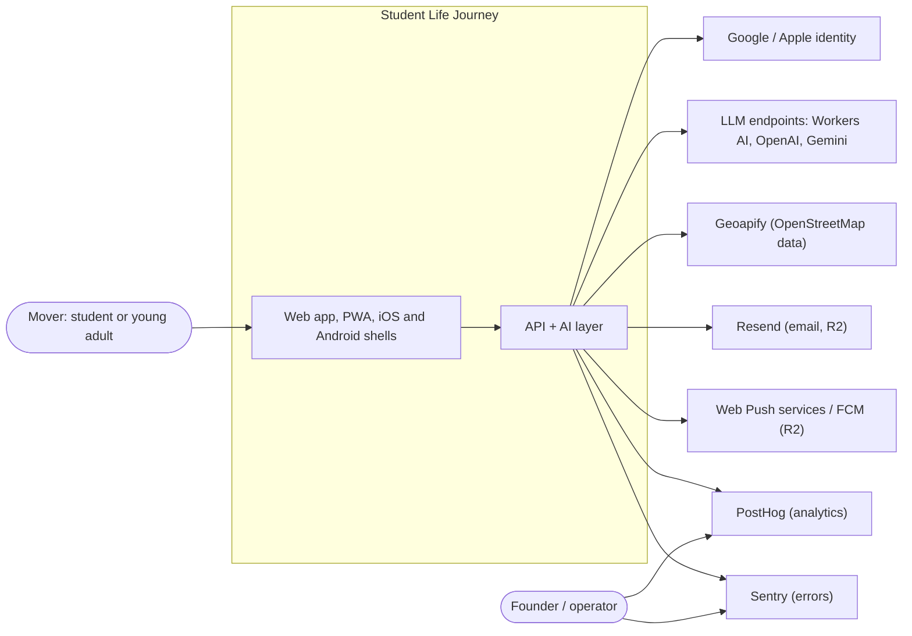
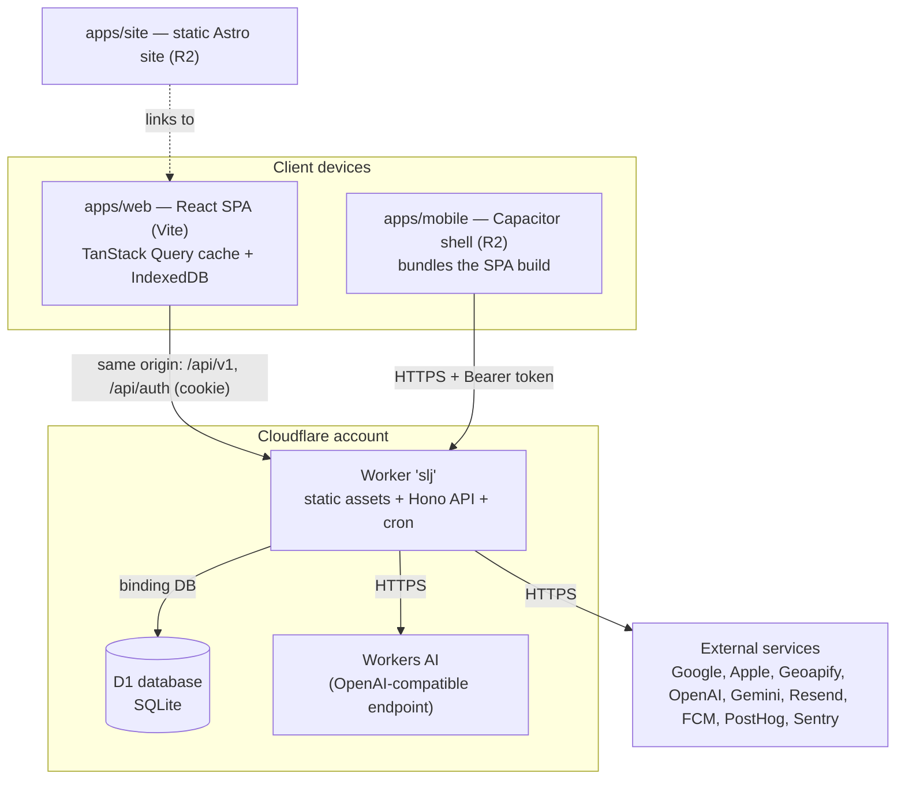
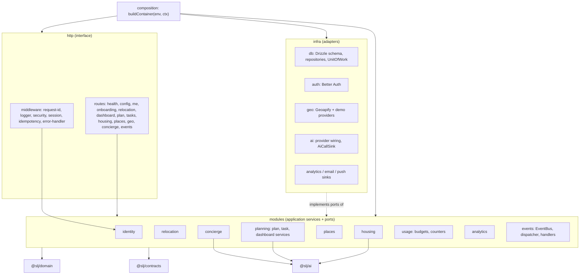

# 03 — Architecture (Architect hat)

**TL;DR**
1. One React SPA (`apps/web`) and one Hono API (`apps/api`) are deployed together as a single Cloudflare Worker with a D1 (SQLite) database.
2. Shared TypeScript packages carry the domain rules (`@slj/domain`), the API contracts (`@slj/contracts`) and the AI layer (`@slj/ai`).
3. Seams exist only where migration will happen: database (repositories), auth (`SessionResolver`), AI vendor (`AIProvider`), places (`PlacesProvider`), hosting (Hono entry file).
4. Dependencies point inward: `http → modules → domain`; `infra` implements ports; a lint rule enforces it.
5. Non-functional targets are numbers (section 17), each with a test or dashboard that checks it.

Decisions are made in the ADRs; this document shows how they fit together.

---

## 1. System context (C4 level 1)



## 2. Containers (C4 level 2)



| Container | Technology | Responsibility | Deployed as |
|---|---|---|---|
| `apps/web` | Vite 8, React 19, Tailwind 4 | All product screens; offline cache; platform adapters | Static files inside the Worker; also bundled into shells |
| `apps/api` | Hono 4 on Workers | REST API, auth, application services, AI wiring, cron | Worker `slj-<env>` |
| `apps/mobile` (R2) | Capacitor 8 | Native container, sign-in, push, secure storage | App Store, Google Play |
| `apps/site` (R2) | Astro 7 | Landing page, legal pages, city guides | Static assets on the apex domain |
| `packages/domain` | TypeScript + Zod | Pure rules: money, dates, priority, baseline plan, housing math, readiness | Imported by web, api, ai |
| `packages/contracts` | Zod 4 | Request/response schemas, error codes, analytics events | Imported by web, api, api-client |
| `packages/ai` | TypeScript | Router, agents, tools, guardrails, providers, prompts, evals | Imported by api |
| `packages/api-client` | TypeScript | Typed `fetch` client | Imported by web |
| D1 | SQLite | System of record | `slj-prod`, `slj-preview` |

## 3. Components of `apps/api` (C4 level 3)



## 4. Platform strategy

Decided in ADR-0001 (matrix and scores there).

| Platform | Delivery | First release | Auth | Offline |
|---|---|---|---|---|
| Web | Responsive SPA | R0 | Cookie session | From R2 (service worker) |
| Desktop: Windows, macOS, Linux | Installed PWA | R2 | Cookie session | Service worker + persisted cache |
| Android | PWA install in R2; Capacitor app to testers in R2, public in R3 | R2 / R3 | Bearer session | Bundled assets + persisted cache |
| iOS | Home Screen web app in R2; Capacitor app to testers in R2, public in R3 | R2 / R3 | Bearer session | Bundled assets + persisted cache |

Primary strategy: one SPA + PWA + Capacitor. Fallback: Expo rewrite of the client only. Desktop fallback: Tauri 2 on trigger (ADR-0016).

## 5. Stack decision per layer

| Layer | Chosen | Runner-up | Reason in one line | Flip trigger | ADR |
|---|---|---|---|---|---|
| Frontend | Vite + React 19 SPA, React Router 8, TanStack Query 5, React Hook Form 7 | Next.js static export | One mental model; bundles into shells | Two toolchains cost > 1 day/month | 0012 |
| UI | Tide tokens, Tailwind 4, own components on Radix | React Aria Components | Design fidelity with accessible primitives | Two failed audits on a widget | 0013 |
| Mobile shell | Capacitor 8 | Expo | Reuses the web build | App Store 4.2 rejections; WebView jank | 0015 |
| Desktop shell | PWA | Tauri 2 | No signing, no installer | Desktop ≥ 15% of sessions + 10 requests | 0016 |
| Backend | Hono 4 on Cloudflare Workers | Fastify on Node container | $0, no cold start, shared TypeScript | Two libraries cannot run on Workers | 0002 |
| API contract | REST + Zod + OpenAPI | Hono RPC | Any client, `curl`-verifiable | Contract drift bugs | 0011 |
| Database | D1 (SQLite) | Turso; Postgres on trigger | Same engine everywhere, managed, free | 7 GB, 40M writes/month, p95 > 150 ms | 0003 |
| Data access | Drizzle + SQL migrations + repositories | Prisma | Atomic batches on D1, tiny runtime | Early move to Postgres | 0004 |
| Auth | Better Auth (Google, Apple, magic link) | Firebase Authentication | Own data, no vendor, runs on Workers | Spike fails; unpatched CVE > 14 days | 0005, 0006 |
| AI | Own router/agents/tools/guardrails; OpenAI-compatible adapter; heuristic fallback | Agent framework; Vercel AI SDK | Deterministic, bounded cost, testable | Need for autonomous tool loops | 0007, 0008 |
| Maps / places | Geoapify + demo provider | Google Places | Results may be stored; one key | Thin coverage in a market | 0019 |
| Jobs / queues | Outbox + `waitUntil` + Cron Triggers | Cloudflare Queues | Reliable at $0, portable | > 200 pending for 10 min | 0017 |
| Email / notifications | Resend, Web Push, FCM, in-app | Email only | Reach on arrival day | Delivery failures > 5% | 0026 |
| File storage | None in R0–R3. No user uploads | Cloudflare R2 | We deliberately store no documents | A shipped feature needs uploads (PL-30, PL-37) | — |
| Analytics | PostHog EU via first-party pipeline | Amplitude / Mixpanel | Funnels with a content-free taxonomy | Free tier shrinks; legal review | 0020 |
| Error tracking | Sentry | GlitchTip | SDKs for Workers, React, Capacitor | Second seat needed; plan removed | 0021 |
| CI/CD | GitHub Actions → `wrangler deploy` | Cloudflare Workers Builds | One place for lint, tests, deploy | Included compute exhausted monthly | `04` §12 |
| Secrets | Wrangler secrets, `.dev.vars`, GitHub secrets | Doppler / Infisical | No extra vendor | Second engineer | 0024 |
| Feature flags | Typed env flags + `/config` | PostHog flags | Kill switches without releases | > 3 concurrent experiments | 0023 |
| i18n | i18next | FormatJS | Familiar, plugin-free | Complex ICU needs | 0025 |
| Testing | Vitest, Cloudflare Vitest plugin, Playwright, own evals | Jest + Cypress | Real runtime and database in tests | Plugin supports Vitest 5 | 0022 |

## 6. Module boundaries, dependency rule and pattern catalogue

### 6.1 The dependency rule

```
apps/web ──► @slj/api-client ──► @slj/contracts ──► @slj/domain
apps/api:  http ──► modules ──► @slj/domain, @slj/contracts, @slj/ai (types), shared
           infra ──► modules/*/ports.ts (to implement), shared, @slj/domain
           composition ──► http, modules, infra, @slj/ai
packages/ai ──► @slj/domain, @slj/contracts
```

| Rule | Enforced by |
|---|---|
| A package imports only its declared dependencies (ADR-0010 table) | pnpm strict resolution + `tsc` |
| `apps/api/src/modules/**` must not import `hono`, `drizzle-orm`, `better-auth`, `apps/api/src/infra/**` or `apps/api/src/http/**` | `.dependency-cruiser.cjs` rule `modules-are-pure` (S-R0-032) |
| `apps/api/src/http/**` must not import `apps/api/src/infra/**`; it receives services from `c.var.container` | rule `http-uses-container` |
| `packages/domain` imports nothing but `zod`; no `Date.now()`, no `fetch`, no randomness (clock and IDs are parameters) | rule `domain-is-pure` + ESLint `no-restricted-globals` |
| `packages/ai` must not import from `apps/*` | rule `ai-is-portable` |
| A module never imports another module's repository; it calls the other module's service or reacts to its events | rule `no-cross-module-repositories` |
| `apps/web/src/screens/**` must not call `fetch` or import `@capacitor/*`; they use hooks and `apps/web/src/platform` | ESLint `no-restricted-imports`, `no-restricted-globals` |
| No circular dependencies anywhere | dependency-cruiser `no-circular` |

### 6.2 Modules

| Module (`apps/api/src/modules/…`) | Owns tables | Public service | Publishes |
|---|---|---|---|
| `identity` | `profile` (+ Better Auth tables through `infra/auth`) | `ProfileService`, `SessionResolver` port | — |
| `relocation` | `relocation_profile` | `OnboardingService`, `RelocationService` | `OnboardingCompleted`, `ArrivalDateChanged`, `HousingStatusChanged` |
| `planning` | `plan`, `task` | `PlanService`, `TaskService`, `DashboardService`, `UserContextService` | `PlanEnhancementRequested`, `TaskCompleted` |
| `housing` | `housing_option` | `HousingService` | — |
| `places` | `place_cache`, `geocode_cache`, `saved_place` | `PlacesService`, `GeoService` | — |
| `concierge` | `conversation`, `message` | `ConciergeService` | — |
| `usage` | `usage_counter`, `ai_call` | `BudgetService` | — |
| `analytics` | — | `Analytics` | — |
| `events` | `outbox_event`, `idempotency_key` | `EventBus`, `OutboxDispatcher` | — |
| `notifications` (R2) | `notification`, `push_subscription` | `NotificationService` | `ReminderDue` |
| `privacy` (R2) | `audit_log` | `PrivacyService` | `AccountDeletionRequested` |

### 6.3 Pattern catalogue outside the AI layer

AI-layer patterns are in ADR-0007 and `05_AI_ARCHITECTURE.md`.

| Pattern | Class / file | Problem solved | Without it |
|---|---|---|---|
| Repository | `apps/api/src/infra/db/repositories/*-repository.ts` implementing `modules/*/ports.ts` | Services do not know Drizzle or D1; the Postgres move touches one folder | SQL scattered through services, as `db.*` calls are in the prototype |
| Unit of Work | `apps/api/src/infra/db/unit-of-work.ts` | Collects statements from several repositories and commits them as one atomic D1 batch | Partial writes (profile saved, tasks missing) |
| Specification | `packages/domain/src/tasks/priority/specifications.ts` (`SafetySpec`, `ArrivalDependencySpec`, `DeadlineSpec`, `FinancialImpactSpec`, `HousingBlockerSpec`, `PhaseRelevanceSpec`) | Each priority rule is a small object returning points and a reason; rules are combined, tested and explained independently | One scoring function with hidden interactions (the prototype's `scoreTask` has an inverted rule, D-08) |
| State | `packages/domain/src/journey/phase.ts` (`PreArrival`, `ArrivalDay`, `FirstWeek`, `Settling`) | Behaviour that depends on where the user is in the journey (which tasks are relevant, dashboard copy, reminder set) lives in one object per state | `if (days > 0) … else if …` repeated in services and UI |
| Observer | `apps/api/src/modules/events/event-bus.ts` + handlers | Modules react to facts without calling each other | `OnboardingService` calling `PlanService` calling analytics directly |
| Adapter | `infra/geo/geoapify-*.ts`, `infra/analytics/posthog-sink.ts`, `infra/email/resend-sender.ts` | External APIs behind our ports | Vendor shapes leaking into services |
| Null Object | `infra/geo/demo-places.ts`, no-op `AnalyticsSink`, `HeuristicProvider` | Missing keys degrade to safe, labelled behaviour instead of `if (key)` checks everywhere | The prototype's `flags.liveAI` / `flags.liveMaps` branches |
| Value Object | `packages/domain/src/money/money.ts` | Money cannot be mixed across currencies or use floats | `Float` budgets (D-09) |
| Factory (composition root) | `apps/api/src/composition/container.ts` | One place wires ports to adapters per request | Module-level singletons holding bindings |
| Strategy | `NotificationChannel` implementations (R2) | Delivery channels are interchangeable | Channel `switch` in the scheduler |

## 7. API style, versioning and route inventory

Style and versioning rules are in ADR-0011. Every route below has a contract file in `packages/contracts/src` and a creating story.

| Method and path | Auth | Purpose | Story |
|---|---|---|---|
| `GET /api/v1/health` | public | Liveness, version | S-R0-006 |
| `GET /api/v1/config` | public | Flags, `minClientVersion`, legal versions | S-R0-007 |
| `ALL /api/auth/*` | public | Better Auth (sign-in, callback, sign-out, session) | S-R0-013 |
| `POST /api/test/session` | token, dev/test only | Create a session for tests | S-R0-015 |
| `GET /api/v1/me` | session | User, profile, onboarding state | S-R0-014 |
| `PATCH /api/v1/me` | session | Display name, locale, units, currency, consent | S-R1-022 |
| `PUT /api/v1/onboarding` | session | Save relocation profile; from R1 also create the baseline plan | S-R0-025, S-R1-017, S-R1-032 |
| `GET /api/v1/relocation` | session | Read relocation profile | S-R0-025 |
| `PATCH /api/v1/relocation` | session | Change route, dates, budget, housing; emits events | S-R1-021 |
| `GET /api/v1/dashboard` | session | Countdown, phase, top priorities, next action | S-R0-027, S-R1-020, S-R2-010 |
| `GET /api/v1/plan` | session | Plan summary and tasks grouped by phase | S-R1-019 |
| `POST /api/v1/plan/regenerate` | session | Rebuild baseline, reconcile, request enhancement | S-R1-019 |
| `GET /api/v1/tasks` | session | List tasks (`?status=`) | S-R1-018 |
| `POST /api/v1/tasks` | session | Create a personal task | S-R1-018 |
| `PATCH /api/v1/tasks/{id}` | session | Complete, reopen, dismiss, rename | S-R1-018 |
| `DELETE /api/v1/tasks/{id}` | session | Delete a personal task | S-R1-018 |
| `POST /api/v1/housing/evaluate` | session | Deterministic costs, verdict, flags, explanation | S-R1-025, S-R1-060 |
| `POST /api/v1/housing/extract` | session | Pasted listing text → candidate fields with evidence | S-R1-060 |
| `GET/POST /api/v1/housing/options` | session | List and save options | S-R1-024 |
| `PATCH/DELETE /api/v1/housing/options/{id}` | session | Update, archive | S-R1-024 |
| `GET /api/v1/places/essential` | session | Nearby places for a category | S-R1-029 |
| `GET/POST /api/v1/places/saved`, `DELETE /api/v1/places/saved/{id}` | session | User's saved places | S-R1-030 |
| `GET /api/v1/geo/autocomplete` | session | Destination and address suggestions | S-R1-031 |
| `POST /api/v1/concierge/messages` | session | Send a message; SSE reply | S-R1-058 |
| `GET/DELETE /api/v1/concierge/conversation` | session | Read or clear the conversation | S-R1-058 |
| `POST /api/v1/events` | session | Client analytics batch | S-R1-086 |
| `GET /api/v1/openapi.json` | public | OpenAPI document | S-R1-087 |
| `POST /api/v1/me/export` | fresh session | Data export (R2) | S-R2-018 |
| `DELETE /api/v1/me` | fresh session | Account deletion (R2) | S-R2-019 |
| `GET /api/v1/notifications`, `POST /api/v1/notifications/{id}/read`, `POST /api/v1/notifications/read-all` | session | Notification centre (R2) | S-R2-033 |
| `GET/PUT /api/v1/notifications/preferences` | session | Channel and reminder preferences (R2) | S-R2-039 |
| `POST /api/v1/push/subscriptions`, `DELETE /api/v1/push/subscriptions/{id}` | session | Web Push and FCM registrations (R2) | S-R2-038, S-R2-051 |
| `POST /api/v1/feedback` | session | In-app feedback (R2) | S-R2-059 |
| `POST /api/v1/waitlist` | public, rate-limited | Landing-page waitlist (R2) | S-R2-058 |
| `GET /api/v1/referral`, `POST /api/v1/referral/claim` | session | Referral code and attribution (R3) | S-R3-012 |
| `POST /api/v1/paywall/interest` | session | Arrival Pass fake door (R3) | S-R3-034 |

Mapping from spec §17: `POST /api/onboarding` → `PUT /api/v1/onboarding`; `POST /api/tasks/:id/complete` → `PATCH /api/v1/tasks/{id}`; `POST /api/housing/move-in-cost` → folded into `POST /api/v1/housing/evaluate` (the prototype route re-ran the whole evaluation, D-13); `POST /api/plan/generate` → `POST /api/v1/plan/regenerate`; `POST /api/agent/chat` → `POST /api/v1/concierge/messages`.

## 8. Offline and sync

Decided in ADR-0014. Summary: service worker app shell (web) or bundled assets (shells); TanStack Query cache persisted to IndexedDB for 7 days; three queued mutation types with idempotency keys; housing math on device; last-write-wins conflicts; cache and outbox cleared on sign-out.

## 9. Push notifications

Decided in ADR-0026. Every reminder is a `notification` row first. Channels: in-app, email (Resend), Web Push (VAPID from the Worker), FCM for native shells. Opt-in after value; one push and one email per user per day at most; no content on the lock screen beyond a generic line.

## 10. Internationalisation

Decided in ADR-0025. English from R0 with no string literals in JSX; Spanish and Simplified Chinese in R3. Money is `{ amountMinor, currency }`, formatted with `Intl.NumberFormat`. Distances convert from metres by `profile.units`. The arrival date is a local calendar date in the destination time zone. Layout uses logical properties (RTL-ready).

## 11. Error model

`AppError` (class in `apps/api/src/shared/errors.ts`) carries `code`, `message`, `status` and optional `details`. Services throw `AppError` subclasses; `apps/api/src/http/middleware/error-handler.ts` turns any error into the envelope `{ "error": { "code", "message", "details?", "requestId" } }`. Codes are the `ErrorCode` enum in `packages/contracts/src/errors.ts`.

| `ErrorCode` | HTTP | Thrown when | Client behaviour |
|---|---|---|---|
| `VALIDATION_FAILED` | 422 | Body, query or params fail the Zod schema | Show field errors from `details.issues` |
| `UNAUTHENTICATED` | 401 | No valid session | Clear session, go to sign-in |
| `FORBIDDEN` | 403 | Origin check failed; action not allowed | Show generic message |
| `NOT_FOUND` | 404 | Record missing or not owned by the user | Refetch list; toast |
| `ONBOARDING_REQUIRED` | 409 | A feature needs a relocation profile | Redirect to onboarding |
| `CONFLICT` | 409 | State changed underneath (e.g. task already deleted) | Refetch; toast |
| `IDEMPOTENCY_CONFLICT` | 409 | Same `Idempotency-Key` with a different body | Drop the queued mutation |
| `RATE_LIMITED` | 429 | Daily count limit reached (`details.limit`, `details.resetsAt`) | Show calm limit message |
| `UNSUPPORTED_CLIENT` | 426 | `X-Client-Version` below `minClientVersion` | Show update screen |
| `UPSTREAM_UNAVAILABLE` | 503 | A required provider failed and no cache or fallback exists | Show retry state |
| `INTERNAL` | 500 | Anything unexpected | Show retry state; Sentry event |

AI budget exhaustion is **not** an error: replies continue from the heuristic provider with `budgetLevel: "EXHAUSTED"` in the response metadata. Unknown records and records owned by someone else both return `NOT_FOUND` so IDs cannot be probed.

## 12. Idempotency

- Mutating requests from the client outbox send `Idempotency-Key: <uuid>`.
- `apps/api/src/http/middleware/idempotency.ts` (S-R1-016) looks up `(user_id, key)` in `idempotency_key`. If found with the same request hash it returns the stored status and body; with a different hash it throws `IDEMPOTENCY_CONFLICT`. Otherwise it runs the handler and stores the response in the same batch as the write when possible.
- Keys expire after 24 hours (daily maintenance cron).
- `PUT /api/v1/onboarding` and `PATCH` routes are idempotent by construction; `POST` routes that create records require the header from R2 clients and accept its absence from `curl`.
- Outbox handlers are idempotent by event ID (ADR-0017).

## 13. Rate limiting

There is no shared in-memory state on Workers and KV allows only 1,000 writes a day on Free, so limits are daily counters in D1 (`usage_counter`, S-R1-023), checked by `BudgetService`.

| Counter key | Limit per user per day | Applies to | On limit |
|---|---|---|---|
| `concierge_msgs` | 40 | `POST /concierge/messages` | Heuristic replies, `budgetLevel: "EXHAUSTED"` |
| `ai_cost_micro_usd` | 30,000 | All LLM calls | ECONOMY at 21,000; EXHAUSTED at 30,000 (ADR-0008) |
| `plan_regens` | 6 | `POST /plan/regenerate` | `RATE_LIMITED` |
| `extractions` | 20 | `POST /housing/extract` | `RATE_LIMITED`; manual entry still works |
| `geo_calls` | 60 | `GET /geo/autocomplete` | Empty suggestions; free text accepted |
| `places_upstream` | 30 | Cache-missing place searches | Cached or empty state |
| `client_events` | 200 | `POST /events` | Events dropped silently |
| `task_creates` | 100 | `POST /tasks` | `RATE_LIMITED` |
| `geo_credits` (global) | 2,800 | All Geoapify calls | Live lookups pause until 00:00 UTC |

Sign-in endpoints use Better Auth's built-in rate limiter keyed by `cf-connecting-ip`. `POST /api/v1/waitlist` allows 5 requests per hashed IP per day. Volumetric attacks are left to Cloudflare's network-level protection; the "traffic day" runbook is in `08_HOSTING_AND_SCALING_LADDER.md` §9.

## 14. Caching

| What | Where | Key | TTL | Invalidation |
|---|---|---|---|---|
| Static assets | Cloudflare edge + browser | Hashed file names | 1 year, immutable | New build |
| `index.html` | Edge + browser | Path | `no-cache` | Every request revalidates |
| API responses for user data | Not cached at the edge (`Cache-Control: private, no-store`) | — | — | — |
| Client server-state | TanStack Query (memory + IndexedDB from R2) | Query key incl. user ID | `staleTime` 30 s; persisted 7 days | Mutations invalidate by key; sign-out clears |
| Places | D1 `place_cache` | provider + category + cell | 30 days | Expiry |
| Geocode and autocomplete | D1 `geocode_cache` | Normalised text | 180 / 30 days | Expiry |
| Config | Client | — | 10 minutes | Refetch on focus |
| AI responses (R3) | D1 `ai_cache` | Task + input hash + prompt version | 24 h – 30 days by task | Prompt version bump |
| Session | Not cached at rung 0 | — | — | ADR-0006 |

## 15. Feature flags

Decided in ADR-0023. Flags are defined in `apps/api/src/config/flags.ts`, valued by the `FLAGS` variable, evaluated on the server and delivered through `GET /api/v1/config`. Kill switches: `aiEnabled`, `conciergeEnabled`, `listingPasteEnabled`, `placesLiveEnabled`, `signupsOpen`.

## 16. Configuration

| Environment | Worker name | D1 database | Origin | Purpose |
|---|---|---|---|---|
| `dev` | local `wrangler dev` (port 8787) behind Vite (port 5173) | local SQLite file | `http://localhost:5173` | Daily development |
| `test` | `workerd` inside Vitest | isolated per test file | — | CI and local tests |
| `preview` | `slj-preview` | `slj-preview` | `https://slj-preview.<subdomain>.workers.dev` | Pull-request verification; shared, last deploy wins |
| `production` | `slj-production` | `slj-prod` | `https://slj-production.<subdomain>.workers.dev` until R2, then `https://app.studentlifejourney.com` | Real users |

All variables and secrets are listed in ADR-0024. The Worker validates them with Zod on first use; `production` refuses weak or missing secrets.

## 17. Non-functional requirements

| Area | Target | Checked by |
|---|---|---|
| Availability | 99.5% monthly at rungs 0–1; 99.9% from rung 2 | External uptime check on `/api/v1/health` (Sentry uptime monitor) |
| API latency, non-AI | p95 ≤ 300 ms reads, ≤ 400 ms writes (server time ≤ 100 ms) | Request log fields `durationMs`; weekly review |
| Concierge | First token p95 ≤ 2.5 s; full reply p95 ≤ 10 s | `ai_call.latency_ms` |
| Baseline plan at onboarding | Server time ≤ 500 ms, no LLM | Integration test asserts no provider call |
| Worker CPU | p99 ≤ 8 ms per request on Free | Spike S-R0-043; Cloudflare metrics |
| Cold start | None perceived; Worker startup ≤ 200 ms | Cloudflare metrics |
| Database calls | ≤ 8 per request (batch = 1) | `countQueries()` assertion in integration tests |
| Web performance | Initial JS ≤ 200 kB gzip; CSS ≤ 30 kB gzip; LCP ≤ 2.5 s, INP ≤ 200 ms, CLS ≤ 0.1 on a mid-range phone over 4G | `size-limit` (S-R1-091); Lighthouse CI (S-R3-037) |
| Offline | Cached screens render ≤ 1 s with no network | Playwright offline test (S-R2-005) |
| Stability | Crash-free sessions ≥ 99.5% (shells); error-free sessions ≥ 99% (web) | Sentry |
| Accessibility | WCAG 2.2 AA; zero serious or critical axe violations | S-R1-090, S-R2-014 |
| AI safety | Safety golden set 100%; fallback rate ≤ 15% | CI evals; `ai_call` |
| AI cost | ≤ $0.05 per active user per month; hard caps per ADR-0008 | `usage_counter`; S-R3-025 alerts |
| Recovery | RPO ≤ 1 hour within 7 days (D1 Time Travel); RPO ≤ 7 days after account-level loss (weekly export); RTO ≤ 2 hours | Restore rehearsal S-R2-026 |
| Security | OWASP ASVS Level 1 checklist passed before public launch | S-R2-027 |
| Privacy | Export within 30 seconds; deletion complete within 24 hours | S-R2-018, S-R2-019 tests |
