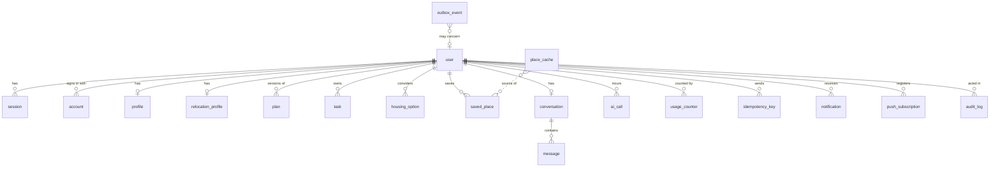
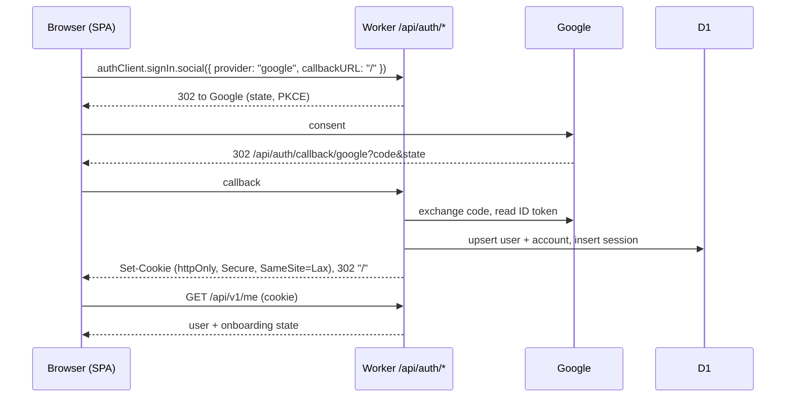
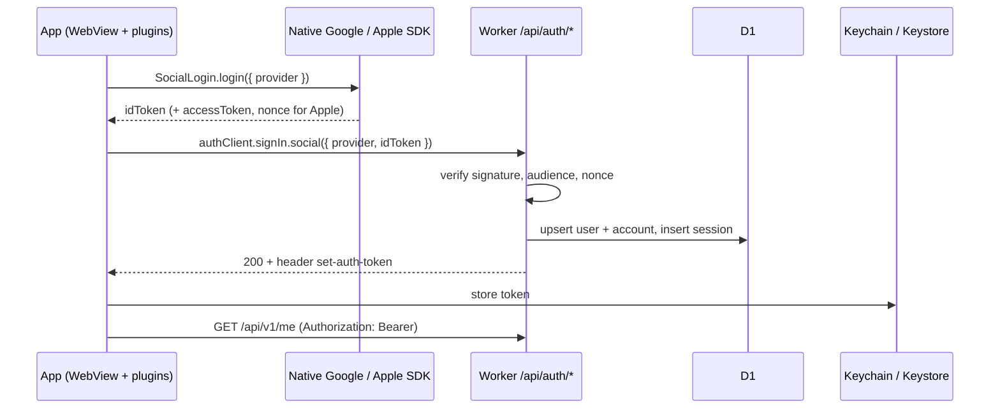

# 06 — Data and Auth (Architect + Security hats)

**TL;DR**
1. One relational schema on SQLite (Cloudflare D1), written in Drizzle with a portable subset so a later move to Postgres is mechanical.
2. Money is integer minor units, calendar dates are text, instants are epoch milliseconds, enums are checked text, lists are JSON text.
3. Durability is D1 Time Travel (7 days on Free) plus a weekly encrypted export kept off-platform; the Postgres runbook is in section 9.
4. Auth is Better Auth in our own database: Google in R0, Apple and magic link in R2, cookie sessions on web and Bearer tokens in shells.
5. We collect the minimum: no passwords, no document numbers, no date of birth, no precise device location, no interests.

Decisions: ADR-0003, ADR-0004, ADR-0005, ADR-0006, ADR-0020, ADR-0024.

---

## 1. Entity-relationship diagram



`place_cache`, `geocode_cache` and global `usage_counter` rows are shared and hold no user identifier.

## 2. Target data model

Auth tables (`user`, `session`, `account`, `verification`) are generated by `npx auth@latest generate` into `apps/api/src/infra/db/schema/auth.ts` (S-R0-012) and are not edited by hand. Application tables follow. Common columns `createdAt` and `updatedAt` are `integer({ mode: "timestamp_ms" }).notNull()` and are set in repositories.

```ts
// apps/api/src/infra/db/schema/relocation.ts   (S-R0-024)
export const relocationProfile = sqliteTable("relocation_profile", {
  userId: text("user_id").primaryKey().references(() => user.id, { onDelete: "cascade" }),
  origin: text("origin").notNull(),
  destination: text("destination").notNull(),
  destinationCountryCode: text("destination_country_code"),
  destinationLat: real("destination_lat"),
  destinationLng: real("destination_lng"),
  destinationTz: text("destination_tz"),
  arrivalDate: text("arrival_date").notNull(),                       // YYYY-MM-DD
  arrivalTime: text("arrival_time"),                                 // HH:mm
  monthlyBudgetMinor: integer("monthly_budget_minor"),
  housingStatus: text("housing_status", { enum: ["SEARCHING", "SECURED"] }).notNull(),
  housingBudgetMinor: integer("housing_budget_minor"),
  transportPrefs: text("transport_prefs", { mode: "json" }).$type<TransportPref[]>().notNull(),
  homeLabel: text("home_label"),                                     // coarse, user-typed, e.g. "Downtown Phoenix"
  homeLat: real("home_lat"),
  homeLng: real("home_lng"),
  onboardingCompletedAt: integer("onboarding_completed_at", { mode: "timestamp_ms" }),
  createdAt: integer("created_at", { mode: "timestamp_ms" }).notNull(),
  updatedAt: integer("updated_at", { mode: "timestamp_ms" }).notNull(),
});

// apps/api/src/infra/db/schema/profile.ts   (S-R1-022, S-R1-032)
export const profile = sqliteTable("profile", {
  userId: text("user_id").primaryKey().references(() => user.id, { onDelete: "cascade" }),
  displayName: text("display_name"),
  locale: text("locale").notNull(),                                  // default "en" set in code
  currency: text("currency").notNull(),                              // ISO 4217, default "USD"
  units: text("units", { enum: ["metric", "imperial"] }).notNull(),
  analyticsConsent: text("analytics_consent", { enum: ["unset", "granted", "denied"] }).notNull(),
  ageConfirmedAt: integer("age_confirmed_at", { mode: "timestamp_ms" }),
  termsVersion: text("terms_version"),
  privacyVersion: text("privacy_version"),
  createdAt: integer("created_at", { mode: "timestamp_ms" }).notNull(),
  updatedAt: integer("updated_at", { mode: "timestamp_ms" }).notNull(),
});

// apps/api/src/infra/db/schema/planning.ts   (S-R1-012)
export const plan = sqliteTable("plan", {
  id: text("id").primaryKey(),
  userId: text("user_id").notNull().references(() => user.id, { onDelete: "cascade" }),
  version: integer("version").notNull(),
  summary: text("summary").notNull(),
  generatedBy: text("generated_by").notNull(),                       // "baseline" or "ai:<providerId>"
  trigger: text("trigger", { enum: ["onboarding", "manual", "arrival_date_changed",
    "housing_status_changed", "profile_changed", "enhancement"] }).notNull(),
  contextHash: text("context_hash").notNull(),
  createdAt: integer("created_at", { mode: "timestamp_ms" }).notNull(),
}, (t) => [uniqueIndex("plan_user_version_uq").on(t.userId, t.version)]);

export const task = sqliteTable("task", {
  id: text("id").primaryKey(),
  userId: text("user_id").notNull().references(() => user.id, { onDelete: "cascade" }),
  title: text("title").notNull(),
  reason: text("reason"),
  priority: text("priority", { enum: ["CRITICAL", "HIGH", "MEDIUM", "LOW"] }).notNull(),
  phase: text("phase", { enum: ["BEFORE_ARRIVAL", "FIRST_24_HOURS", "FIRST_7_DAYS", "ONGOING"] }).notNull(),
  dayIndex: integer("day_index"),                                    // 1–7 for FIRST_7_DAYS
  category: text("category", { enum: ["TRAVEL", "HOUSING", "CONNECTIVITY", "FOOD", "TRANSPORT",
    "MONEY", "SAFETY", "HEALTH", "DAILY_LIVING"] }).notNull(),
  status: text("status", { enum: ["OPEN", "DONE", "DISMISSED"] }).notNull(),
  source: text("source", { enum: ["BASELINE", "AI", "USER"] }).notNull(),
  templateKey: text("template_key"),                                 // stable key for BASELINE and AI tasks
  estimateMinutes: integer("estimate_minutes"),
  dueDate: text("due_date"),                                         // YYYY-MM-DD
  sortOrder: integer("sort_order").notNull(),
  completedAt: integer("completed_at", { mode: "timestamp_ms" }),
  createdAt: integer("created_at", { mode: "timestamp_ms" }).notNull(),
  updatedAt: integer("updated_at", { mode: "timestamp_ms" }).notNull(),
}, (t) => [
  index("task_user_status_idx").on(t.userId, t.status),
  uniqueIndex("task_user_template_uq").on(t.userId, t.templateKey),  // NULLs are distinct on SQLite and Postgres
]);

// apps/api/src/infra/db/schema/outbox.ts   (S-R1-014, S-R1-016)
export const outboxEvent = sqliteTable("outbox_event", {
  id: text("id").primaryKey(),
  type: text("type").notNull(),
  payload: text("payload", { mode: "json" }).$type<Record<string, unknown>>().notNull(),
  userId: text("user_id"),
  status: text("status", { enum: ["PENDING", "PROCESSING", "DONE", "FAILED"] }).notNull(),
  attempts: integer("attempts").notNull(),
  availableAt: integer("available_at", { mode: "timestamp_ms" }).notNull(),
  lastError: text("last_error"),
  createdAt: integer("created_at", { mode: "timestamp_ms" }).notNull(),
  processedAt: integer("processed_at", { mode: "timestamp_ms" }),
}, (t) => [index("outbox_status_available_idx").on(t.status, t.availableAt)]);

export const idempotencyKey = sqliteTable("idempotency_key", {
  userId: text("user_id").notNull(),
  key: text("key").notNull(),
  route: text("route").notNull(),
  requestHash: text("request_hash").notNull(),
  responseStatus: integer("response_status").notNull(),
  responseBody: text("response_body").notNull(),
  createdAt: integer("created_at", { mode: "timestamp_ms" }).notNull(),
}, (t) => [primaryKey({ columns: [t.userId, t.key] })]);

// apps/api/src/infra/db/schema/usage.ts   (S-R1-023, S-R1-041)
export const usageCounter = sqliteTable("usage_counter", {
  subject: text("subject").notNull(),                                // user id, or "global"
  period: text("period").notNull(),                                  // "YYYY-MM-DD" (UTC day) or "YYYY-MM"
  key: text("key").notNull(),                                        // see 03_ARCHITECTURE.md §13
  value: integer("value").notNull(),
}, (t) => [primaryKey({ columns: [t.subject, t.period, t.key] })]);

export const aiCall = sqliteTable("ai_call", {
  id: text("id").primaryKey(),
  userId: text("user_id").references(() => user.id, { onDelete: "cascade" }),
  task: text("task").notNull(),
  intent: text("intent"),
  topic: text("topic"),
  tier: text("tier", { enum: ["CHEAP", "STRONG"] }).notNull(),
  providerId: text("provider_id").notNull(),
  promptId: text("prompt_id").notNull(),
  promptVersion: integer("prompt_version").notNull(),
  inputTokens: integer("input_tokens").notNull(),
  outputTokens: integer("output_tokens").notNull(),
  costMicroUsd: integer("cost_micro_usd").notNull(),
  latencyMs: integer("latency_ms").notNull(),
  outcome: text("outcome", { enum: ["ok", "fallback", "blocked", "error"] }).notNull(),
  fallbackReason: text("fallback_reason"),
  guardrails: text("guardrails", { mode: "json" }).$type<string[]>().notNull(),
  budgetLevel: text("budget_level", { enum: ["NORMAL", "ECONOMY", "EXHAUSTED"] }).notNull(),
  createdAt: integer("created_at", { mode: "timestamp_ms" }).notNull(),
}, (t) => [index("ai_call_created_idx").on(t.createdAt)]);

// apps/api/src/infra/db/schema/housing.ts   (S-R1-024)
export const housingOption = sqliteTable("housing_option", {
  id: text("id").primaryKey(),
  userId: text("user_id").notNull().references(() => user.id, { onDelete: "cascade" }),
  label: text("label").notNull(),
  inputs: text("inputs", { mode: "json" }).$type<HousingInputs>().notNull(),      // minor units
  riskFlags: text("risk_flags", { mode: "json" }).$type<RiskKey[]>().notNull(),
  inputSource: text("input_source", { enum: ["MANUAL", "PASTE"] }).notNull(),
  monthlyTotalMinor: integer("monthly_total_minor").notNull(),
  moveInTotalMinor: integer("move_in_total_minor").notNull(),
  verdict: text("verdict", { enum: ["COMPATIBLE", "TIGHT", "OVER", "UNKNOWN"] }).notNull(),
  archivedAt: integer("archived_at", { mode: "timestamp_ms" }),
  createdAt: integer("created_at", { mode: "timestamp_ms" }).notNull(),
  updatedAt: integer("updated_at", { mode: "timestamp_ms" }).notNull(),
}, (t) => [index("housing_option_user_idx").on(t.userId, t.archivedAt)]);

// apps/api/src/infra/db/schema/places.ts   (S-R1-027, S-R1-028, S-R1-030)
export const geocodeCache = sqliteTable("geocode_cache", {
  key: text("key").primaryKey(),
  payload: text("payload", { mode: "json" }).$type<unknown>().notNull(),
  fetchedAt: integer("fetched_at", { mode: "timestamp_ms" }).notNull(),
  expiresAt: integer("expires_at", { mode: "timestamp_ms" }).notNull(),
});
export const placeCache = sqliteTable("place_cache", {
  provider: text("provider").notNull(),
  category: text("category").notNull(),
  cell: text("cell").notNull(),
  payload: text("payload", { mode: "json" }).$type<unknown>().notNull(),
  fetchedAt: integer("fetched_at", { mode: "timestamp_ms" }).notNull(),
  expiresAt: integer("expires_at", { mode: "timestamp_ms" }).notNull(),
}, (t) => [primaryKey({ columns: [t.provider, t.category, t.cell] })]);
export const savedPlace = sqliteTable("saved_place", {
  id: text("id").primaryKey(),
  userId: text("user_id").notNull().references(() => user.id, { onDelete: "cascade" }),
  provider: text("provider").notNull(),
  externalId: text("external_id").notNull(),
  name: text("name").notNull(),
  category: text("category", { enum: ["GROCERY", "PHARMACY", "HEALTHCARE", "TRANSIT", "LAUNDRY"] }).notNull(),
  address: text("address").notNull(),
  lat: real("lat").notNull(),
  lng: real("lng").notNull(),
  savedAt: integer("saved_at", { mode: "timestamp_ms" }).notNull(),
}, (t) => [uniqueIndex("saved_place_user_ext_uq").on(t.userId, t.provider, t.externalId)]);

// apps/api/src/infra/db/schema/concierge.ts   (S-R1-057)
export const conversation = sqliteTable("conversation", {
  id: text("id").primaryKey(),
  userId: text("user_id").notNull().unique().references(() => user.id, { onDelete: "cascade" }),
  summary: text("summary"),
  summarizedTurns: integer("summarized_turns").notNull(),
  createdAt: integer("created_at", { mode: "timestamp_ms" }).notNull(),
  updatedAt: integer("updated_at", { mode: "timestamp_ms" }).notNull(),
});
export const message = sqliteTable("message", {
  id: text("id").primaryKey(),
  conversationId: text("conversation_id").notNull().references(() => conversation.id, { onDelete: "cascade" }),
  role: text("role", { enum: ["USER", "ASSISTANT"] }).notNull(),
  content: text("content").notNull(),                                // redacted text
  agent: text("agent"),
  intent: text("intent"),
  createdAt: integer("created_at", { mode: "timestamp_ms" }).notNull(),
}, (t) => [index("message_conversation_created_idx").on(t.conversationId, t.createdAt)]);
```

Tables added later (columns fixed in their stories):

| Table | Release | Purpose | Key columns |
|---|---|---|---|
| `notification` | R2 (S-R2-033) | In-app notifications | `id`, `user_id`, `key`, `title`, `body`, `action_url`, `read_at`, `created_at` |
| `push_subscription` | R2 (S-R2-038) | Web Push and FCM registrations | `id`, `user_id`, `kind`, `endpoint_or_token`, `keys` (JSON), `last_seen_at` |
| `audit_log` | R2 (S-R2-022) | Sensitive actions | `id`, `user_ref` (hashed), `action`, `meta` (JSON), `created_at` |
| `feedback` | R2 (S-R2-059) | In-app feedback | `id`, `user_id`, `kind`, `message`, `created_at` |
| `waitlist_entry` | R2 (S-R2-058) | Landing-page waitlist | `id`, `email`, `source`, `created_at` |
| `referral` | R3 (S-R3-012) | Codes and attribution | `code`, `inviter_user_id`, `invitee_user_id`, `created_at` |
| `ai_cache` | R3 (S-R3-020) | Cached AI results | `key`, `value` (JSON), `expires_at` |
| `paywall_interest` | R3 (S-R3-034) | Fake-door sign-ups | `user_id`, `offer`, `created_at` |

`profile` gains `notification_prefs` (JSON) in S-R2-039 and `reminder_checked_on` (text date) in S-R2-036.

## 3. Cross-engine compatibility

The portable-subset rules and the list of incompatibilities in the prototype schema are in ADR-0003. Divergences that will exist between the SQLite schema and a future Postgres schema, all mechanical:

| SQLite (today) | Postgres (later) | Data conversion |
|---|---|---|
| `integer` epoch ms | `timestamptz` | `to_timestamp(ms / 1000.0)` |
| `text` JSON | `jsonb` | cast |
| `integer` 0/1 | `boolean` | `value = 1` |
| `text` date | `date` | cast |
| `real` coordinates | `double precision` | none |
| `integer` money | `bigint` | none |
| `text` + enum in Drizzle (type-level) | `text` + `CHECK` | none |

SQLite `CHECK` constraints for enum columns are added in the migration SQL by hand where drizzle-kit does not emit them; Zod validation at the boundary is the primary guard.

## 4. Migration strategy and tooling

| Step | Command | Notes |
|---|---|---|
| Change the schema | edit `apps/api/src/infra/db/schema/*.ts` | — |
| Generate SQL | `pnpm --filter @slj/api db:generate -- --name <snake_name>` | Writes `apps/api/migrations/NNNN_<snake_name>.sql`; review and commit it |
| Apply locally | `pnpm --filter @slj/api db:migrate:local` | `wrangler d1 migrations apply slj-local --local` |
| Tests | automatic | `apps/api/test/setup.ts` applies all files to each isolated test database |
| Apply to preview / production | deploy workflow (`04` §12) | `wrangler d1 migrations apply <db> --remote --env <env>`; a failed migration is rolled back by D1 |

Rules: forward-only; never edit an applied migration; every migration is compatible with the previous and the next application version (expand, then contract one release later); destructive changes need a founder-reviewed story; before a risky migration note the Time Travel bookmark (`wrangler d1 time-travel info slj-prod`).

## 5. Seeds and fixtures

- **No production seed.** Reference data (task templates, place categories, emergency numbers) is code, not rows.
- **Dev demo data:** `apps/api/src/dev/demo-data.ts` builds the design's demo mover ("Alex", Chicago → Phoenix, arriving in 12 days at 15:40, $2,400 monthly budget, housing searching at $1,250) through the real services, exposed as `POST /api/test/seed-demo` in `dev` only and run with `pnpm --filter @slj/api seed:dev` (S-R1-092).
- **Test fixtures:** builder functions in `apps/api/test/helpers/db.ts` (`aUser()`, `aRelocationProfile()`, `aTask()`), each with sensible defaults and overrides. Tests never share state: D1 storage is isolated per test file and each test creates what it needs.
- **Eval fixtures:** synthetic JSON only (`packages/ai/evals/cases`).

## 6. Repository pattern and transaction rules

```ts
// apps/api/src/modules/planning/ports.ts  (example)
export interface TaskRepository {
  listByUser(userId: string, filter?: { status?: TaskStatus }): Promise<Task[]>;
  findById(userId: string, taskId: string): Promise<Task | null>;
  /** Statements only; nothing is executed until the unit of work commits. */
  insertMany(uow: UnitOfWork, tasks: NewTask[]): void;
  updateStatus(uow: UnitOfWork, userId: string, taskId: string, status: TaskStatus, now: number): void;
}

// apps/api/src/infra/db/unit-of-work.ts
export interface UnitOfWork {
  add(statement: BatchItem<"sqlite">): void;
  /** Runs every added statement in one atomic D1 batch. Returns per-statement results. */
  commit(): Promise<unknown[]>;
}
```

Rules:

1. Every repository method that touches user data takes `userId` and filters by it. There is no "find by id" without the owner.
2. Reads return domain types; rows never leave `infra/db`.
3. Writes go through a `UnitOfWork` created by the service; one `commit()` per use case. A use case with a single write may call a convenience method that creates and commits its own unit of work.
4. No read-then-write inside a unit of work. Preconditions go into `WHERE` clauses; the service inspects affected-row counts and throws `ConflictError` or `NotFoundError`.
5. Counters use `INSERT … ON CONFLICT … DO UPDATE SET value = value + ?`.
6. Multi-row inserts are chunked to ≤ 100 bound parameters per statement.
7. An endpoint makes at most 8 database calls; tests assert it with `countQueries()`.
8. `db.transaction()` is banned by lint (ADR-0004).

## 7. Indexes tied to real queries

| Query | Used by | Index |
|---|---|---|
| Open tasks for a user | Dashboard, tasks list, user context | `task_user_status_idx (user_id, status)` |
| Upsert a baseline task by template | Plan reconciliation | `task_user_template_uq (user_id, template_key)` |
| Latest plan for a user | Plan screen | `plan_user_version_uq (user_id, version)` |
| Pending events due now | Outbox dispatcher | `outbox_status_available_idx (status, available_at)` |
| Replay lookup | Idempotency middleware | primary key `(user_id, key)` |
| Counter read and increment | Budget service | primary key `(subject, period, key)` |
| Active options for a user | Housing | `housing_option_user_idx (user_id, archived_at)` |
| Cached places for a cell | Places | primary key `(provider, category, cell)` |
| Last N messages | Concierge | `message_conversation_created_idx (conversation_id, created_at)` |
| Purge old AI calls | Maintenance cron | `ai_call_created_idx (created_at)` |
| Session by token | Every authenticated request | Better Auth's unique index on `session.token` |

## 8. Deletion, audit, retention, backup and restore

**Deletion.** Hard delete, no soft-delete flags: deleting a `user` row cascades to every table with a `user_id` foreign key. `housing_option.archived_at` is the only archive flag and exists for the user's own "remove from list" action.

**Audit (R2).** `audit_log` records sign-in from a new device, export, deletion request, sign-out-everywhere and consent changes, keyed by the hashed user reference so entries survive account deletion without identifying the person.

**Retention.**

| Data | Kept for | Removed by |
|---|---|---|
| Account, profile, relocation profile, tasks, housing options, saved places | Until the user deletes the account; accounts inactive for 24 months are deleted after an email warning | S-R2-019, S-R2-021 |
| Plan versions | Latest 10 per user | S-R1-019 (on insert) |
| Conversation messages | 90 days | S-R2-021 |
| `ai_call` | 30 days | S-R2-021 |
| Outbox events | `DONE` 7 days, `FAILED` 30 days | S-R1-015 |
| Idempotency keys | 24 hours | S-R1-016 / maintenance cron |
| Place and geocode cache | Until `expires_at` | S-R1-027, S-R1-028 |
| Notifications | 90 days | S-R2-021 |
| Audit log | 12 months | S-R2-021 |
| Sessions | 30 days sliding; expired rows purged daily | Better Auth + S-R2-021 |
| Waitlist emails | Until public launch + 90 days | S-R2-021 |
| Analytics events (PostHog) | 12 months | PostHog project setting (S-R1-083) |
| Error events (Sentry) | 30 days | Plan default |
| Database exports | 8 weekly files | S-R2-025 |

**SQLite durability plan (decided).**

| Layer | Mechanism | Covers | Recovery point |
|---|---|---|---|
| 1 | D1's managed storage and replication | Hardware failure | 0 |
| 2 | D1 Time Travel (`wrangler d1 time-travel restore slj-prod --timestamp=<ISO>`) | Bad migration, bad deploy, accidental deletes | Any minute in the last 7 days (30 on Paid) |
| 3 | Weekly `wrangler d1 export slj-prod --remote --output=slj-prod.sql`, encrypted with `age` to a public key in the repo, stored as a GitHub Actions artifact for 56 days (S-R2-025) | Loss of the Cloudflare account or the database itself | Up to 7 days |

Litestream, LiteFS and volume snapshots are not used: there is no file system or VM to attach them to, and D1 already provides point-in-time recovery. Until S-R2-025 ships, layers 1 and 2 are the backup; the R0 runbook (S-R0-042) documents layer 2.

**Restore procedure** (rehearsed in S-R2-026): (1) set flag `signupsOpen` false and announce maintenance; (2) note the current bookmark; (3) `time-travel restore` to the chosen timestamp, or for layer 3 create a new database, `wrangler d1 execute <new-db> --remote --file=slj-prod.sql`, and repoint the binding; (4) run the verification queries of section 9; (5) reopen. Target: under 2 hours.

## 9. SQLite → Postgres migration runbook

Run only when an ADR-0003 trigger fires. Rehearsed once in R3 against a free Postgres instance (S-R3-027).

**Preparation (days before)**

1. Create the Postgres database and a Cloudflare Hyperdrive configuration; add binding `HYPERDRIVE` to `wrangler.jsonc`.
2. Port `apps/api/src/infra/db/schema/*.ts` to `drizzle-orm/pg-core` in a parallel folder `schema-pg/` using the mapping in section 3; generate Postgres migrations into `apps/api/migrations-pg/`.
3. Implement `apps/api/src/infra/db/client-pg.ts` and make repositories accept either client behind the existing ports (most query-builder code is unchanged; `batch` becomes a real transaction inside `UnitOfWork`).
4. Run the full integration suite against Postgres in CI (a second Vitest project using the Node adapter and a Postgres service container).

**Copy script outline** (`apps/api/scripts/copy-sqlite-to-pg.ts`, S-R3-026)

```text
1. Read the SQL export produced by `wrangler d1 export slj-prod --remote --no-schema`
   (or page through tables with the D1 HTTP API, 1,000 rows per request).
2. For each table in dependency order
   [user, account, session, verification, profile, relocation_profile, plan, task, housing_option,
    saved_place, conversation, message, usage_counter, notification, push_subscription, audit_log, referral]:
     a. transform each row: epoch ms → timestamptz, 0/1 → boolean, JSON text → jsonb, date text → date
     b. COPY or batched INSERT (500 rows) into Postgres
3. Skip caches and transient tables: place_cache, geocode_cache, ai_cache, idempotency_key, outbox_event (must be empty), ai_call.
4. Print per-table row counts for both sides.
```

**Verification queries** (must match on both sides)

```sql
SELECT COUNT(*) FROM "user";
SELECT COUNT(*), SUM(CASE WHEN status = 'DONE' THEN 1 ELSE 0 END) FROM task;
SELECT COUNT(*), MAX(version) FROM plan;
SELECT COUNT(*), SUM(monthly_total_minor), SUM(move_in_total_minor) FROM housing_option;
SELECT COUNT(*) FROM message;
SELECT user_id, COUNT(*) FROM task GROUP BY user_id ORDER BY COUNT(*) DESC LIMIT 20;
-- spot check: 20 random users compared field by field by the script
```

**Cutover (expected read-only window 15–30 minutes)**

1. Set `signupsOpen` false; deploy a version with flag `maintenanceReadOnly` true (mutating routes return 503 with a friendly message; reads continue).
2. Wait for the outbox to drain (`SELECT COUNT(*) FROM outbox_event WHERE status IN ('PENDING','PROCESSING')` = 0).
3. Export, copy, verify.
4. Deploy the version whose container uses `client-pg.ts`; run the smoke tests; turn `maintenanceReadOnly` off.
5. Keep D1 untouched for 14 days.

**Rollback:** redeploy the previous version (D1 client). Data written to Postgres after cutover would be lost, so roll back only within the first minutes or after replaying from Postgres with the same script reversed. **Expected cost after the move:** a managed Postgres plan plus Hyperdrive (rung 3 in `08_HOSTING_AND_SCALING_LADDER.md`).

## 10. Auth decision

Decided in ADR-0005 (matrix there): Better Auth 1.7 with Google (R0), Apple and magic link (R2). No passwords. Fallback: Firebase Authentication behind the same `SessionResolver` port.

## 11. Auth flows and Google OAuth setup

**Web and desktop PWA (R0)**



**iOS and Android shells (R2)**



**Magic link (R2):** the user enters an email; the Worker stores a single-use token (10 minutes) in `verification` and sends a link through Resend; opening it on the same device creates the session. In shells the link is an app link handled by S-R2-048.

**Desktop:** the PWA uses the web flow. A future Tauri shell would use the system browser with a loopback redirect and PKCE, then the Bearer path (ADR-0016).

**Google Cloud setup (S-R0-011 for web, S-R2-042 for native)**

| Step | Value |
|---|---|
| Project | One Google Cloud project named `student-life-journey` |
| Consent screen | External; app name "Student Life Journey"; support email; scopes `openid`, `email`, `profile` only; publishing status "In production" (the testing status limits who can sign in; V-35) |
| Web client | Type "Web application"; authorised redirect URIs `http://localhost:5173/api/auth/callback/google`, the production Worker URL + `/api/auth/callback/google`, and from R2 `https://app.studentlifejourney.com/api/auth/callback/google` |
| Android client (R2) | Type "Android"; package `app.studentlifejourney`; SHA-1 of the upload key and of the Play App Signing key |
| iOS client (R2) | Type "iOS"; bundle ID `app.studentlifejourney` |
| Server config | `GOOGLE_CLIENT_ID`, `GOOGLE_CLIENT_SECRET` (web); `GOOGLE_IOS_CLIENT_ID`, `GOOGLE_ANDROID_CLIENT_ID` appended to the `clientId` array for ID-token audience checks |

## 12. Session and token model, linking, sign-out

Decided in ADR-0006. Opaque sessions in `session`, 30-day sliding expiry; cookie on web, Bearer in shells; sign-out deletes the row; "sign out everywhere" calls `revokeSessions()`; export and deletion need a session younger than 24 hours.

**Account linking.** Better Auth links automatically when a trusted provider (`google`, `apple`) returns an email that matches an existing user. Apple's private relay addresses do not match, so Settings offers "Link Google" / "Link Apple" (`authClient.linkSocial`, S-R2-060). Magic-link sign-in with an email that already belongs to a Google account signs into the same user because the email is proven by the link. Unlinking the last sign-in method is not allowed.

## 13. CSRF, XSS, rate limiting, secrets

| Topic | Posture | Story |
|---|---|---|
| CSRF | SameSite=Lax cookie; origin check (Hono `csrf()` with the app origin) on non-GET `/api/v1/*` cookie requests; Better Auth `trustedOrigins`; Bearer requests carry no ambient credential | S-R0-035 |
| XSS | React escaping; no `dangerouslySetInnerHTML`; LLM text rendered as plain text with line breaks, never as HTML or Markdown-to-HTML; Content-Security-Policy: `default-src 'self'; script-src 'self'; style-src 'self' 'unsafe-inline'; img-src 'self' data:; connect-src 'self' https://*.ingest.sentry.io; frame-ancestors 'none'; base-uri 'self'; form-action 'self' https://accounts.google.com` | S-R0-035 |
| Other headers | `X-Content-Type-Options: nosniff`, `Referrer-Policy: strict-origin-when-cross-origin`, `Permissions-Policy` denying camera, microphone and geolocation, HSTS on the custom domain | S-R0-035 |
| Rate limiting | Daily counters in D1 (`03_ARCHITECTURE.md` §13); Better Auth limiter on auth routes | S-R1-023 |
| Secrets | ADR-0024 | S-R0-007 |
| Dependencies | Lockfile; Renovate; `pnpm audit` and gitleaks in CI | S-R0-031 |
| Authorisation | Ownership filter in every repository method; unknown and foreign IDs both return `NOT_FOUND`; cross-user tests per route group | S-R1-088 |

## 14. Threat model

**STRIDE by component**

| Component | Spoofing | Tampering | Repudiation | Information disclosure | Denial of service | Elevation of privilege |
|---|---|---|---|---|---|---|
| Web app / shells | Phishing clone of the sign-in page | Local cache edits | — | Cached data on a shared device | — | XSS running as the user |
| API | Stolen session or Bearer token | Parameter tampering, replayed mutations | No audit trail for sensitive actions | IDOR across users; verbose errors | Request floods; expensive endpoints | Test-support route reachable in production |
| Auth | OAuth misbinding, linking takeover | Callback tampering, open redirect | — | Email enumeration | Sign-in floods | Unverified email linked to an existing account |
| Database | — | Bad migration | — | Backup leak | Daily write cap exhausted | Over-broad API token |
| AI layer | — | Prompt injection altering output | — | PII sent to vendors; prompt leakage | Cost exhaustion | Model output triggering state changes |
| Third parties | Vendor impersonation | Poisoned place data | — | Data shared beyond need | Provider outage | — |

**Top threats**

| ID | Threat | Likelihood | Impact | Mitigation | Owning story |
|---|---|---|---|---|---|
| TH-01 | Session theft through XSS | Low | High | httpOnly cookie, strict CSP, plain-text rendering of model output, no inline scripts | S-R0-035 |
| TH-02 | Cross-site request forgery on mutations | Low | High | SameSite=Lax + origin check + trusted origins | S-R0-035 |
| TH-03 | Reading or changing another user's records by ID (IDOR) | Medium | High | Mandatory `userId` filter in repositories; cross-user test suite | S-R1-018, S-R1-088 |
| TH-04 | Account takeover through automatic linking | Low | High | Only Google and Apple are trusted providers; no password accounts; linking UI requires a fresh session | S-R0-013, S-R2-060 |
| TH-05 | Prompt injection through pasted listings or chat | High | Medium | Isolation, delimiters, schema-only output, evidence verification, guardrails, golden set | S-R1-048, S-R1-054, S-R1-063 |
| TH-06 | Personal data leaking to LLM vendors, logs or analytics | Medium | High | Redaction before storage and sending; typed content-free events; logging rules | S-R1-045, S-R1-048, S-R1-084, S-R0-009 |
| TH-07 | Cost exhaustion ("denial of wallet") | Medium | Medium | Per-user and global budgets, daily counters, kill switch | S-R1-023, S-R3-021 |
| TH-08 | Test-support endpoint or token present in production | Low | Critical | Route registered only in `dev`/`test`; `parseEnv` refuses `TEST_SUPPORT_TOKEN` in preview and production; test asserts 404 | S-R0-015, S-R0-007 |
| TH-09 | Secret leaked in the repository, CI logs or the client bundle | Medium | High | gitleaks, `.gitignore`, only `VITE_` variables reach the client, scoped Cloudflare token | S-R0-031, S-R0-007 |
| TH-10 | Data loss from a bad migration or deploy | Low | High | Forward-only compatible migrations, Time Travel, weekly export, restore rehearsal | S-R0-042, S-R2-025, S-R2-026 |

Further threats tracked in the security review (S-R2-027): open redirect through `callbackURL`, Bearer token theft on a compromised device, scraping of geo endpoints, dependency supply chain, lock-screen disclosure in notifications, enumeration through the waitlist form.

## 15. Privacy

This section is engineering guidance, not legal advice (V-34). The privacy notice and terms are reviewed by a qualified person before public launch (A-17, S-R2-024).

### 15.1 Data inventory and classification

Classes: **C1** operational (no person), **C2** personal, **C3** sensitive personal (needs extra care: location of a home, money, free text).

| Data | Class | Why we hold it | Where | Shared with |
|---|---|---|---|---|
| Email, name, avatar URL from Google or Apple | C2 | Account identity | `user`, `account` | — |
| Session token, IP address and user agent of the session | C2 | Security | `session` | — |
| Origin and destination cities, arrival date and time | C2 | Plan and priorities | `relocation_profile` | City name to the LLM vendor; typed place text to Geoapify |
| Monthly and housing budgets | C3 | Verdicts | `relocation_profile` | Amounts to the LLM vendor as facts, without identity |
| Home label and optional home coordinates | C3 | Anchor for nearby places | `relocation_profile` | Coordinates rounded to a 1 km cell to Geoapify; never to the LLM |
| Tasks and plan summaries | C2 | Core feature | `task`, `plan` | Titles and reasons to the LLM vendor |
| Housing option inputs and risk flags | C3 | Cost math | `housing_option` | Numbers to the LLM vendor |
| Pasted listing text | C3 (third-party content) | Extraction only | Not stored; processed in memory | LLM vendor, isolated call |
| Conversation messages (redacted) | C3 | Continuity | `message` | LLM vendor |
| Saved places | C2 | Offline essentials | `saved_place` | — |
| Usage counters, AI call metadata | C2 | Budgets, reliability | `usage_counter`, `ai_call` | — |
| Analytics events | C2 (pseudonymous) | Product decisions | PostHog | PostHog |
| Error reports | C1–C2 (scrubbed) | Reliability | Sentry | Sentry |
| Notification endpoints and tokens (R2) | C2 | Delivery | `push_subscription` | Push services, FCM |

Subprocessors to list in the privacy notice: Cloudflare (hosting, database, Workers AI), Google and Apple (sign-in), the configured LLM vendors, Geoapify, PostHog, Sentry, Resend (R2), Google Firebase Cloud Messaging (R2).

### 15.2 What we deliberately do not collect

Passwords; passport, visa, national ID or student numbers; date of birth (only a 16+ attestation); nationality, gender or ethnicity; phone number; exact street address (the home field is a coarse label, and coordinates are optional); device GPS location (no geolocation permission is requested in R0–R3); contacts; photos or documents; bank or card details; university, course or employer; interests; advertising identifiers.

### 15.3 Lawful basis and consent

| Processing | Basis (GDPR terms) | Consent text requirement |
|---|---|---|
| Account, plan, tasks, housing math, places, concierge | Performance of the service the user asked for | Shown at sign-in: "By continuing you agree to the Terms and acknowledge the Privacy Notice" with links |
| Sending context to AI vendors | Same; disclosed | Onboarding line: "Your answers are processed by AI providers to write your plan. We remove your name and contact details first." |
| Analytics | Consent in the EEA, United Kingdom and Switzerland; legitimate interest with opt-out elsewhere | A separate, unticked choice: "Help improve the app with anonymous usage statistics" |
| Reminder emails | Consent; one-tap unsubscribe | Toggle in onboarding (R2) and Settings |
| Push | Device permission + in-app toggle | Asked only after the user taps "Remind me" |
| Age | Attestation | Unticked box: "I am 16 or older" (required to continue) |

Consent is recorded as `terms_version`, `privacy_version`, `age_confirmed_at` and `analytics_consent` on `profile`. A new version of either document asks again on the next launch.

### 15.4 Data subject requests

| Request | Flow | Time | Story |
|---|---|---|---|
| Access / portability | Settings → "Download my data" → `POST /api/v1/me/export` returns one JSON file with every row that references the user, plus a README of field meanings | Immediate | S-R2-018 |
| Deletion | Settings → "Delete my account" → confirm with a fresh session → `DELETE /api/v1/me` → `AccountDeletionRequested` → cascade delete, session revocation, PostHog person deletion, audit entry with hashed reference, confirmation email | Complete within 24 hours, normally seconds | S-R2-019 |
| Rectification | Edit in Settings | Immediate | S-R1-081 |
| Restriction / objection | Analytics and reminders toggles; "Clear conversation" | Immediate | S-R1-081, S-R2-039 |
| Requests by email | `privacy@studentlifejourney.com`, answered within 30 days | — | S-R2-024 |

Until R2 ships, deletion and export requests are handled manually by the founder with SQL against D1; the beta privacy notice says so (S-R1-082).

### 15.5 Minors

The service is for people aged 16 or older and is not directed to children. Onboarding requires the attestation. If we learn that a user is under 16, the account is deleted. There is no parental-consent flow (PL-23). Store listings use the corresponding age rating.

### 15.6 Regions

- **Launch assumption:** United States (A-01). CCPA/CPRA posture: we do not sell or share personal information; access and deletion are self-serve; the notice lists categories and purposes.
- **EEA / UK / Switzerland:** analytics is opt-in; the notice names the controller, the legal bases above, retention periods, subprocessors and transfer mechanisms (the vendors' standard contractual clauses); data-processing agreements are accepted with each vendor before launch (S-R2-024).
- **Database location:** the production D1 database is created with a location hint for eastern North America while the launch market is the United States; changing region means creating a new database and using the restore procedure in section 8.
