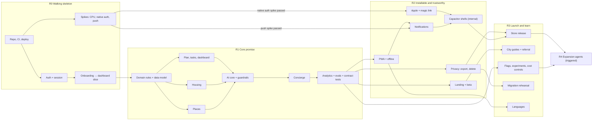

# 10 — Release Plan (Release Manager + CEO hats)

**TL;DR**
1. Five releases: R0 walking skeleton, R1 core promise, R2 installable and trustworthy, R3 launch and learn, R4 expansion by trigger.
2. 253 stories: R0 47, R1 95, R2 62, R3 40, R4 9. One founder with AI executors needs about 19 weeks to finish R3.
3. R0 ships first because it retires the riskiest unknowns (stack, auth, deploy) with the thinnest real slice; section 3 defends that order.
4. Every release has measurable exit criteria and a rollback path; nothing ships without one.
5. If time runs out, the cutline in section 4 says exactly what falls off, in order.

---

## 1. Overview

| Release | Theme | Platforms shipped | Stories | Weeks (cumulative) | Gate |
|---|---|---|---|---|---|
| R0 | Walking skeleton | Web (production, unlisted) | 47 | 1–3 | S-R0-045 |
| R1 | Core promise | Web, mobile-first and desktop layouts | 95 | 4–10 | S-R1-095 |
| R2 | Installable and trustworthy | PWA on desktop, Android, iOS Home Screen; Capacitor builds to internal testers | 62 | 11–15 | S-R2-062 |
| R3 | Launch and learn | App Store and Google Play public; marketing site | 40 | 16–19 | S-R3-016, S-R3-040 |
| R4 | Expansion | As above | 9 (each gated) | From month 6 | Triggers in `14_PARKING_LOT.md` |

Velocity assumption (A-02): about 25 founder hours a week; AI executors implement, the founder reviews, merges and does HUMAN chores; 12–16 stories a week. If actual velocity over the first two weeks is below 10 stories a week, re-plan dates, not scope order.

## 2. Releases

### R0 — Walking skeleton ("hello, mover")

| Field | Content |
|---|---|
| Goal | Prove the whole stack end to end in production with one real slice |
| User-visible outcome | Sign in with Google → two-step onboarding → dashboard showing the countdown and one computed priority |
| Entry criteria | This plan accepted; founder has a Cloudflare account, a Google Cloud project and repository admin rights (S-R0-011, S-R0-036 can run in parallel with early stories) |
| Stories by epic | **Repo Foundation:** S-R0-001, 002, 003, 004, 031, 032, 033, 041, 046 · **Platform Runtime:** 005, 006, 007, 008, 010, 021, 037, 038 · **Observability:** 009, 040 · **Identity:** 012, 013, 014, 015, 022, 023 · **Design System:** 016, 017, 018, 019, 028 · **Internationalisation:** 020 · **Onboarding:** 024, 025, 029 · **Plan and Tasks:** 026, 027, 030 · **Quality:** 034, 043 · **Privacy and Trust:** 035 · **Mobile Shell:** 044 · **Notifications:** 047 · **Operations:** 042 · **Human Chores:** 011, 036, 039, 045 |
| Exit criteria (all measurable) | 1. On the production URL a new Google account completes sign-in → onboarding → dashboard and sees a priority computed from its own answers (evidence in S-R0-045). 2. CI is green on `main`, including the Playwright smoke journey. 3. The deploy workflow has deployed `main` automatically at least twice; one code rollback has been rehearsed on preview. 4. A deliberate test error appears in Sentry from both the API and the web app. 5. Spikes S-R0-043, S-R0-044 and S-R0-047 have written reports with a pass, or a recorded fallback decision on the board. 6. `GET /api/v1/dashboard` p95 ≤ 300 ms over 20 production samples. 7. `/api/test/session` returns 404 in production. |
| Environments | `dev`, `test`, `preview`, `production` |
| Rollout | Direct deploy from `main`. URL is unlisted; `signupsOpen` true |
| Rollback | Section 6 (code only; there is no user data worth restoring yet) |
| Comms | None external. Board updated |
| Success metrics | Exit criteria; time from first commit to first production deploy |
| Estimate | Weeks 1–3 |

Deliberately **not** in R0: tasks, plan, housing, places, concierge, any LLM call, analytics, offline, mobile shells (beyond the spike), landing page.

### R1 — Core promise

| Field | Content |
|---|---|
| Goal | Deliver the promise of spec §1 on the web: tell us five facts, we tell you what to do next |
| User-visible outcome | Full onboarding; baseline plan enhanced by AI; ranked tasks; housing cost and move-in math with paste and compare; essential places; grounded concierge; settings; legal pages |
| Entry criteria | R0 exit criteria met; ADR-0000 spikes resolved; decision recorded for the S-R1-058 variant (streamed or not) |
| Stories by epic | **Housing:** S-R1-001, 002, 003, 004, 024, 025, 054, 060, 075, 076, 077, 078 · **Plan and Tasks:** 005, 006, 007, 008, 009, 010, 011, 012, 017, 018, 019, 020, 059, 072, 073, 074 · **Platform Runtime:** 013, 014, 015, 016 · **Onboarding:** 021, 022, 071, 081 · **AI Core:** 023, 033, 034, 035, 036, 037, 038, 039, 040, 042, 043, 044, 045, 046, 047, 048, 049, 050, 051, 052, 053, 056, 061 · **Places:** 027, 028, 029, 030, 031, 079 · **Privacy and Trust:** 032, 082 · **Observability:** 041, 084, 085, 086 · **Concierge:** 055, 057, 058, 080 · **Quality:** 062, 063, 064, 087, 088, 089, 090, 091 · **Design System:** 065, 066, 067, 068, 069, 070 · **Repo Foundation:** 092, 093 · **Human Chores:** 026, 083, 094, 095 |
| Exit criteria | 1. The 13 acceptance criteria of spec §25 pass as named end-to-end tests. 2. Safety golden set 100%; quality set ≥ 90%. 3. With no LLM secrets configured, every screen works. 4. Zero serious or critical axe violations on nine screens. 5. Initial JavaScript ≤ 200 kB gzip. 6. Five timed first-use sessions with people outside the project: median time to dashboard ≤ 90 seconds. 7. Every core event of the taxonomy is visible in PostHog from production. 8. Privacy notice and terms are live and linked from sign-in. 9. `legacy/` is deleted. 10. Non-AI p95 ≤ 300 ms; concierge first token p95 ≤ 2.5 s (or the non-streamed variant ≤ 8 s). |
| Milestone inside R1 | **R1-alpha** when S-R1-072, 073 and 074 are done: invite up to 10 people who arrive within six weeks; collect notes only |
| Environments | As R0 |
| Rollout | Closed beta: the unlisted URL is given to recruited testers (`11_GO_TO_MARKET.md` §2). Flags `conciergeEnabled`, `listingPasteEnabled`, `placesLiveEnabled` allow partial rollback |
| Rollback | Section 6; D1 Time Travel for data |
| Comms | Personal invitations; a pinned "what works, what doesn't" note for testers |
| Success metrics | Activation ≥ 40%; onboarding completion ≥ 70%; AI fallback rate ≤ 15%. The 8-week kill-or-continue clock starts when the first recruited tester onboards |
| Estimate | Weeks 4–10 |

### R2 — Installable and trustworthy

| Field | Content |
|---|---|
| Goal | Make it something people can keep, trust and come back to |
| User-visible outcome | Installable PWA with offline plan and tasks; reminders by notification centre, email and push; Apple and magic-link sign-in; data export and account deletion; readiness score and My Life; dark theme; landing page with waitlist; iOS and Android builds for testers |
| Entry criteria | R1 exit criteria met; domain bought (S-R2-028); Apple and Google developer accounts opened (S-R2-040, 041) |
| Stories by epic | **Offline and Install:** S-R2-001 to 008 · **Plan and Tasks:** 009, 010, 011 · **Design System:** 012, 013 · **Quality:** 014, 015 · **Internationalisation:** 016 · **Observability:** 017, 053 · **Privacy and Trust:** 018, 019, 020, 021, 022, 023, 024, 027 · **Operations:** 025, 026 · **Platform Runtime:** 029 · **Notifications:** 031, 033, 034, 035, 036, 037, 038, 039, 051, 052 · **Identity:** 032, 047, 060 · **Mobile Shell:** 043, 044, 045, 046, 048, 049, 054, 055 · **Growth:** 056, 057, 058, 059 · **Human Chores:** 028, 030, 040, 041, 042, 050, 061, 062 |
| Exit criteria | 1. The PWA installs from Chrome on Windows, macOS, Linux and Android and from Safari on macOS and iOS (checklist S-R2-008). 2. With the network off, Dashboard, Plan, Tasks, saved places and the housing calculator work; a task toggled offline syncs within 10 seconds of reconnecting. 3. A reminder is delivered through the notification centre and at least one of email or push in production. 4. Export downloads a complete JSON file; deletion removes every row for the user within 24 hours (verified by query). 5. Sign in with Apple and magic link work on web; native Google and Apple sign-in work in both shells. 6. TestFlight and Play internal builds are installed on at least two physical devices each. 7. Manual accessibility audit: no open P0 or P1 findings. 8. Security checklist passed. 9. Database restore rehearsed in under 2 hours. 10. Landing page live on the domain with a working waitlist. 11. At least 30 beta testers recruited. |
| Environments | `production` moves to `app.studentlifejourney.com` |
| Rollout | Open beta on web (landing page links to the app); mobile to internal testers only; `pushEnabled` and `readinessEnabled` start at 20% then 100% (manual flag steps until S-R3-017) |
| Rollback | Section 6, including the service-worker rollback note |
| Comms | Email to the waitlist; posts in the communities that produced R1 testers |
| Success metrics | D7 ≥ 15%; ≥ 30% of weekly users install or add to Home Screen; reminder open rate ≥ 25%; pre-arrival completion ≥ 25% |
| Estimate | Weeks 11–15 |

### R3 — Launch and learn

| Field | Content |
|---|---|
| Goal | Public launch on the stores and the open web, with the machinery to learn |
| User-visible outcome | Apps in the App Store and Google Play; city guides; invite a friend; Spanish and Simplified Chinese; map on Places |
| Entry criteria | R2 exit criteria met; kill-or-continue review held with a "continue" outcome (S-R3-040) before S-R3-016 starts |
| Stories by epic | **Growth:** S-R3-001, 002, 008, 009, 010, 011, 012, 013, 014, 019, 034, 035 · **Human Chores:** 003, 005, 006, 007, 016, 039, 040 · **Mobile Shell:** 004 · **Observability:** 015 · **Operations:** 017, 018, 025, 026, 027, 028, 029 · **AI Core:** 020, 021, 022, 023 · **Quality:** 024, 036, 037 · **Internationalisation:** 030, 031, 032, 033 · **Places:** 038 |
| Exit criteria | 1. Both store listings are public. 2. At least five city guides are live, each with sources and a verification date. 3. Referral links attribute sign-ups end to end. 4. One experiment is running with exposure events. 5. Cost alerts email the founder when a threshold is crossed (tested). 6. The SQLite → Postgres copy has been rehearsed with matching verification queries. 7. Spanish and Simplified Chinese are selectable and pass the key-completeness test. 8. The launch checklist (section 7) is complete through T+7. 9. The T+30 review is held (S-R3-039). |
| Environments | Adds `staging` only if rung 2 is reached |
| Rollout | Android staged 20% → 50% → 100% over 5 days; iOS phased release over 7 days; web features behind percentage flags |
| Rollback | Section 6, including store procedures |
| Comms | Launch sequence in `11_GO_TO_MARKET.md` §10 |
| Success metrics | 1,000 onboarded users within 60 days of launch; activation ≥ 40%; D7 ≥ 25%; ≥ 25% of new users from referrals or named communities; cost per active user ≤ $0.05 |
| Estimate | Weeks 16–19 (store review and the 14-day Play closed test run in parallel with other stories) |

### R4 — Expansion

Each story is built only when its trigger in `14_PARKING_LOT.md` fires (order and thresholds in `05_AI_ARCHITECTURE.md` §16): S-R4-001 connectivity, 002 emergency plan, 003 budget planner, 004 transport routes, 005 grocery planner, 006 health navigation, 007 activities, 008 routine coach, 009 Tauri desktop shell. Each follows the six-step extension recipe and ships behind a flag at 20% first. No calendar estimate.

## 3. Ship order rationale

**What ships first: the walking skeleton (R0), then the core promise on the web (R1).**

| Alternative order | Why it loses |
|---|---|
| **AI first** (concierge and plan before auth, deploy and CI) | The demo impresses, but the riskiest unknowns are not the model: they are whether auth, the free-tier runtime and the deploy path work. The prototype already took this path and ended with code that does not compile and cannot be deployed |
| **All models and services first, UI later** (horizontal layers) | Nothing is verifiable by a user for weeks; weak executors drift without an end-to-end test to anchor them |
| **Mobile apps first** | Store accounts, signing and review add cost and weeks before we know whether anyone wants the product; the web reaches the same users today |
| **Landing page and waitlist first** | Cheap, but it tests interest in a promise, not the product; the first 100 users come from communities where a working link beats a waitlist |
| **Housing calculator alone as the MVP** | A strong candidate (it is pivot A), but alone it does not test bet 1 (next action beats checklist), which is the product's reason to exist |

Inside R1 the order is by risk and value: (1) deterministic domain rules and the data model, because everything else stands on them and they are cheap to test; (2) the plan → tasks → dashboard slice, which is the promise; (3) housing math, the second bet; (4) the AI core with guardrails before any agent, so no unguarded output path ever exists; (5) concierge last, because it depends on everything and is the most replaceable.

R2 comes before public launch because a relocation product that fails offline on arrival day, cannot delete an account, or cannot remind anyone is not trustworthy enough to market. R3's growth work comes last because paid or public acquisition before organic loops exist wastes the scarce resource (attention at the right moment).

## 4. Cutline

If the calendar slips, cut in this order within the release; never reorder releases.

| Release | Cut first → last | Never cut |
|---|---|---|
| R0 | S-R0-046 (spec banners) → S-R0-033 (hooks) → S-R0-047 (push spike; push then waits for rung 1) | Auth, CI, deploy, Sentry, security headers, the other two spikes |
| R1 | S-R1-078 (compare) → S-R1-077 + S-R1-054 (paste; manual entry stays) → S-R1-030 (saved places) → S-R1-064 (quality set) → the LLM classifier inside S-R1-050 (rules only) → S-R1-031 (autocomplete; free text stays) | Guardrails (048, 049), safety set (063), budgets (023), accessibility checks (090), legal pages (082), contract tests (088) |
| R2 | S-R2-012 + 013 (dark theme) → S-R2-060 (account linking UI) → S-R2-038 (web push; email stays) → S-R2-051 + 052 (native push) → S-R2-032 (magic link, only if Apple sign-in ships) → the My Life grid part of S-R2-011 | Export and deletion (018, 019), offline cache (002–005), Sign in with Apple (047), security review (027), restore rehearsal (026) |
| R3 | S-R3-038 (map) → S-R3-032 (Chinese) → S-R3-034 (fake door) → S-R3-035 (partner links) → S-R3-037 (Lighthouse) → S-R3-036 (mobile smoke) → S-R3-014 (email sequence) | Store privacy declarations (003), cost alerts (025), kill switch (021), the Postgres rehearsal (026, 027) |

## 5. Dependency graph

## 6. Rollback procedures

| What broke | Procedure | Time | Data effect |
|---|---|---|---|
| A bad web or API deploy | `pnpm --filter @slj/api exec wrangler rollback --env production` (exact syntax to confirm, V-10), or revert the commit on `main` and let the pipeline redeploy. Then `curl -fsS $PRODUCTION_URL/api/v1/health` | 2–10 minutes | None: code rollback does not touch D1. Migrations are backward compatible for one release, so the previous code still runs |
| A bad feature | Set its flag to false in `FLAGS` for `production` and deploy configuration | 2 minutes | None |
| A bad migration or data corruption | Close sign-ups (`signupsOpen` false); `wrangler d1 time-travel restore slj-prod --timestamp=<before>`; redeploy the matching code; verify with the queries in `06_DATA_AND_AUTH.md` §9 | 30–120 minutes | Writes after the timestamp are lost; announce it |
| A bad service worker (R2+) | Ship a new build; the service worker uses `skipWaiting` + client reload on update. Emergency: deploy a no-op service worker that unregisters itself | 10 minutes + client refresh | None |
| A bad Android build | Halt the staged rollout in Play Console; upload the previous code with a higher version code | Hours | None |
| A bad iOS build | Pause the phased release; submit a fix with expedited review if severe; meanwhile use flags and `minClientVersion` | Hours to days | None |
| A bad prompt or model | Revert the prompt module (version bump) or change the chain variables; guardrails and fallbacks limit exposure meanwhile | 5 minutes | None |
| Third-party outage | Nothing to roll back: fallbacks engage (heuristic AI, cached or demo places, queued notifications) | — | — |

The first rehearsal of the code rollback is part of S-R0-042; the first database restore rehearsal is S-R2-026.

## 7. Launch-day checklist (public launch in R3)

| When | Item | Owner story |
|---|---|---|
| T-14 | Kill-or-continue review done; outcome "continue" | S-R3-040 |
| T-14 | Play closed test with ≥ 12 testers has run ≥ 14 days; production access requested | S-R3-005 |
| T-14 | Store listings, screenshots and privacy declarations complete | S-R3-001, 002, 003 |
| T-10 | iOS build submitted for review with demo account notes | S-R3-006 |
| T-10 | Five city guides published and indexed; sitemap submitted | S-R3-010, 011 |
| T-7 | Cost alerts tested; `AI_MONTHLY_BUDGET_USD` set for launch month; vendor-side spend limit set | S-R3-025, S-R3-021 |
| T-7 | Load test baseline run; rung 0 → 1 upgrade rehearsed or done | S-R3-028, S-R3-029 |
| T-7 | Dashboards ready; weekly review ritual scheduled | S-R3-015 |
| T-5 | Referral links tested end to end | S-R3-012, 013 |
| T-3 | Database export taken and decrypt-tested; Time Travel bookmark noted | S-R2-025 |
| T-3 | Launch posts drafted for each named community, following each community's rules | S-R3-016 |
| T-1 | Feature freeze; only fixes merge; rollback rehearsed on preview | S-R3-016 |
| T-0 | Release Android at 20% and iOS phased; publish posts across the day (not all at once); founder available for replies | S-R3-016 |
| T+0 | Watch: health, error rate, onboarding completion, AI fallback rate, D1 writes, requests | `09` §8 |
| T+1 | Answer every comment and email; fix the top onboarding drop-off if one is obvious | — |
| T+3 | Android to 50%; first experiment on | S-R3-007, S-R3-019 |
| T+5 | Android to 100% if crash-free ≥ 99.5% | S-R3-007 |
| T+7 | First weekly review with launch cohort data; write the five-line launch note on the board | S-R3-016 |
| T+30 | Launch review and next-quarter decision | S-R3-039 |
